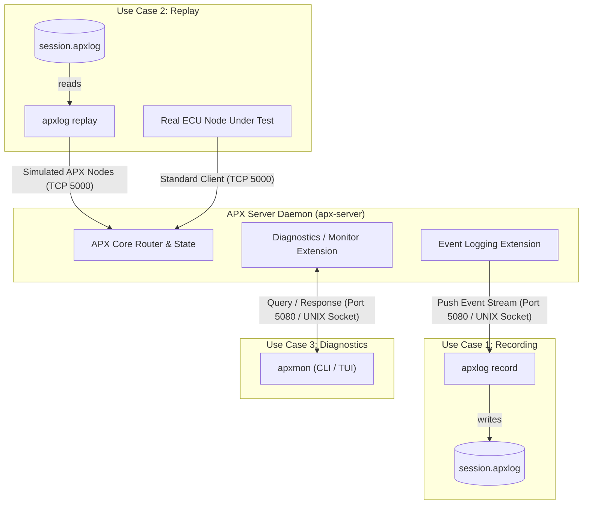

# APX Diagnostics and Event Logging Architecture

## 1. Overview and Problem Statement

The APX system requires runtime introspection, diagnostics, and recording capabilities for both local debugging and remote vehicular telemetry. Previously, roadmap items 2 through 6 conflated three distinct use cases under a single prototype implementation (`apx_info` and an early `apx_monitor_extension`):

1. **Offline Event Logging (Recording)**: High-throughput, passive streaming of server events and signal modifications to a persistent binary file (`.apxlog`).
2. **Log Playback (Replay & Simulation)**: Active injection of recorded event sequences back into an APX server to simulate surrounding nodes while testing or debugging a single node under test.
3. **Interactive Monitoring & Diagnostics (Introspection)**: Bidirectional, on-demand queries to inspect running topology, retrieve node definitions, and identify routing flaws (e.g. unconnected ports).

This document establishes the high-level system architecture, transport segregation, server extension decomposition, and client tooling landscape to serve all three use cases cleanly without compromising real-time performance.

---

## 2. Core Use Cases



### 2.1. Use Case 1: Offline Logging (Event Recording)

* **Objective**: Capture complete system activity over a period of time for post-mortem analysis, signal graphing, validation, or compliance auditing.
* **Workflow**:
  1. The APX server starts and accepts standard client connections on the operational port (default: TCP `5000`).
  2. A recording client (`apxlog record`) connects to the dedicated diagnostic endpoint (TCP port `5080` with TLS or `/run/apx/apx_monitor.socket`).
  3. **Capability Announcement**: The server publishes `server.log` with file type `FileStream` (`RMF_FILE_TYPE_STREAM`).
  4. **Intent-Based Subscription**: The recording client sends an `RMF_CMD_OPEN_FILE` command for `server.log`. Until this file is opened, the server generates zero logging overhead.
  5. **Initial State Snapshot**: Once `server.log` is opened, the server immediately pushes initial state records through the `server.log` stream:
     * All connected client IDs, tags, and connection states.
     * All published `.apx` definitions for active nodes.
     * The initial / current values of all output and input signal ports.
  6. **Live Event Stream**: The server continuously writes timestamped binary event records into the `server.log` stream:
     * New connections and disconnections.
     * Virtual file publications and revocations.
     * Port and file data writes (exact timestamps, addresses, and payload bytes).
  7. The recording client preserves each RemoteFile write as one event and
     prepends a NumHeader32 only when writing the event to the append-only
     `.apxlog` container. The on-disk prefix replaces the RMFP envelope that
     terminates at the recorder.
  8. Upon disconnect or termination (`Ctrl+C`), the `.apxlog` file header and index are finalized.
* **Critical Design Constraint (Zero Real-Time Interference)**:
  > [!IMPORTANT]
  > The event logging mechanism must operate **strictly asynchronously** using lock-free circular ring buffers. If the recorder client is slow (e.g. slow network or busy disk), the server must **drop event records and increment a dropped-event counter** in the stream rather than exerting backpressure or blocking the real-time APX signal routing pipeline.

---

### 2.2. Use Case 2: Log Playback (Replay & Simulation)

* **Objective**: Re-run recorded vehicle or test bench scenarios against an APX server. This allows developers to test a single real ECU node against a simulated fleet of other nodes without needing physical hardware.
* **Workflow**:
  1. An APX server starts with an empty or clean routing state.
  2. The replay tool (`apxlog replay`) inspects a recorded `.apxlog` file.
  3. **Node Filtering**: The operator specifies filtering rules:
     * `--exclude-node <name>`: Exclude specific nodes from playback.
     * `--include-nodes <n1,n2>`: Play back only selected nodes.
     * Example: While developing `BatteryManagementECU`, the operator runs:
       ```bash
       apxlog replay drive_cycle.apxlog --exclude-node BatteryManagementECU
       ```
  4. A real `BatteryManagementECU` instance connects to the APX server over its regular connection.
  5. The replay tool connects to the server as a **standard APX client** (e.g. over TCP port `5000` or standard UNIX socket) and instantiates all non-excluded recorded nodes.
  6. The replay tool reads recorded events, synchronizes its clock to relative event timestamps, and writes port data updates into the server exactly as they occurred in the original recording.
  7. The real `BatteryManagementECU` receives authentic inputs from the simulated nodes and produces outputs into the server routing table.
* **Playback Controls**:
  * **Time Scaling**: `--rate 1.0` (real-time), `--rate 2.0` (2x speed), `--rate 0.5` (half speed).
  * **Step Mode**: `--interactive` (advance one event or time-step on keypress).
  * **Looping**: `--loop` (rewind and replay indefinitely).
* **Architectural Advantage**:
  Because playback connects as a standard multi-node APX client, the APX server requires **zero special playback logic or server-side injection ports**. All existing routing, validation, and port matching mechanisms remain 100% genuine.

---

### 2.3. Use Case 3: Interactive Diagnostics & Monitoring (Introspection)

* **Objective**: Enable operators and automated diagnostics to inspect the health, configuration, and routing state of a running APX server on demand.
* **Workflow**:
  1. The diagnostic client (`apxmon`) connects to the dedicated diagnostic endpoint (port `5080` or UNIX socket).
  2. The server publishes `apx.diag.v1.response` and `apx.diag.v1.notify`
     (type `FileStream`).
  3. The client publishes `apx.diag.v1.request` (type `FileStream`).
  4. The server opens `apx.diag.v1.request`; the client opens
     `apx.diag.v1.response` and, when needed, `apx.diag.v1.notify`.
  5. Each completed RemoteFile write carries one request, response, or
     notification according to its target file.
  6. The client can run a one-shot query and exit, or maintain an open stream for an interactive monitor/TUI session.
* **Diagnostic Capabilities**:
  * **Node & Connection Inspection (`apxmon nodes`)**:
    * Lists all active connections: connection ID, type (`DEFAULT` vs `MONITOR`), remote IP/PID, connection tag, connected timestamp, and attached nodes.
  * **Definition Retrieval (`apxmon get-def <node_name>`)**:
    * Fetches the complete `.apx` IDL text definition for any active node directly from the server's cache or memory.
  * **Routing Table Analysis (`apxmon routing`)**:
    * Displays active signal routing links (Provide Port $\to$ Require Port).
    * Highlights **unconnected / dangling ports** (`apxmon routing --unconnected`):
      * Require ports expecting a signal that has no active provider on the bus.
      * Provide ports producing a signal that has no active consumer.
  * **Live Signal Tapping (`apxmon watch <node>:<port>`)**:
    * Subscribes to updates for specific signals without dumping the full high-volume event log.

---

## 3. Dedicated Transport & Network Segregation

To uphold security, quality-of-service, and deterministic execution, diagnostic and logging traffic is completely separated from the operational signal bus:

| Bus Type | Endpoint Type | Default Port / Path | Purpose |
| :--- | :--- | :--- | :--- |
| **Operational Signal Bus** | TCP / UNIX Socket | TCP `5000` (or `5000+N`)<br>`/run/apx/apx.socket` | Standard client node connections, low-latency signal exchange, deterministic routing. |
| **Diagnostic & Telemetry Bus** | TCP (mTLS) / UNIX Socket | TCP `5080`<br>`/run/apx/apx_monitor.socket` | Privileged administrative access: `apxmon` diagnostics, `apxlog record` event streaming. |

> [!NOTE]
> Diagnostic port `5080` is the default for an APX server on operational port `5000`. By convention, when multiple APX server instances co-exist on the same host, an `apx-server` on operational port `5000 + N` assigns diagnostic port `5080 + N` (e.g. `apx-server@5000` $\to$ diag `5080`, `apx-server@5001` $\to$ diag `5081`).

### Security Guarantees (see `securing_monitor_extension.md`)
* **Local Access**: Protected by POSIX filesystem permissions on `/run/apx/apx_monitor.socket` (e.g. `chmod 0660`, group `apxdiag`).
* **Remote Access (TCP)**: Protected by Mutual TLS (mTLS) requiring dedicated diagnostic client certificates. Standard client certificates are rejected by Subject / EKU verification.

---

## 4. RemoteFile Protocol Integration via Stream Files (`RMF_FILE_TYPE_STREAM`)

A core architectural strength of this design is that **zero modifications to the low-level RemoteFile wire protocol or command area are required**.

In the RemoteFile specifications (`apx/specifications/protocols/remotefile1_0.md` and `remotefile1_1.md`), virtual files support multiple storage models:
* `FixedFile` (`0`): Fixed-size memory region (used for signal memory maps and definition files).
* `DynamicFile` (`1..3`): Dynamically sized buffer with length header.
* `FileStream` (`5` in RMFP 1.1, `2` in RMFP 1.0): Continuous, FIFO streaming channel.

### 4.1. Semantics of `FileStream` in RemoteFile
1. **Logical Message Limit**: When publishing a stream file, `FileSize`
   specifies the maximum logical write accepted by that file.
2. **Fixed Start Address**: Once the stream file is opened, every logical write
   starts at `file->address`.
3. **Message Preservation**: A completed logical write is delivered as one
   stream message. NumHeader frames each RMFP packet, and the RemoteFile
   `MORE_BIT` reassembles a fragmented logical write before the application is
   notified.
4. **No Inner Framing**: An application message does not repeat its size.
   Multiple application messages are not packed into one RemoteFile write.

### 4.2. Capability Announcement & Intent-Based Subscription

Instead of hardcoded greeting sub-modes or custom "logging enable" commands, capability negotiation and subscription use standard RemoteFile file management:

```text
[Diagnostic Client]                                                [APX Server (Port 5080)]
        |                                                                     |
        |================= Standard RMFP 1.1 Handshake =======================|
        |                                                                     |
        |<--- RMF_CMD_PUBLISH_FILE ("server.log", type=FileStream) -----------|  (Announce logging)
        |<--- RMF_CMD_PUBLISH_FILE ("apx.diag.v1.response", FileStream) ------|  (Announce diagnostics)
        |<--- RMF_CMD_PUBLISH_FILE ("apx.diag.v1.notify", FileStream) --------|  (Announce notifications)
        |                                                                     |
        |--- (Scenario A: Logging Client - apxlog record) -------------------|
        |                                                                     |
        |---> RMF_CMD_OPEN_FILE (address of "server.log") ------------------->|  (Subscribe to log stream)
        |<=== RMF File Write (chunked event records into "server.log") =======|  (Streaming active)
        |                                                                     |
        |--- (Scenario B: Diagnostic Client - apxmon) -----------------------|
        |                                                                     |
        |---> RMF_CMD_PUBLISH_FILE ("apx.diag.v1.request", FileStream) ------>|  (Client query channel)
        |<--- RMF_CMD_OPEN_FILE (address of request file) --------------------|  (Server listens for queries)
        |---> RMF_CMD_OPEN_FILE (address of response file) ------------------>|  (Client listens for replies)
        |                                                                     |
        |===> RMF File Write (one request message) ===========================>|  (Send query)
        |<=== RMF File Write (one response message) ===========================|  (Receive reply)
```

* **Zero Overhead for Unused Services**: The server only generates and formats data for files that have been explicitly opened by the client:
  * If a client connects and never opens `server.log`, the logging ring buffer and serialization code are never engaged.
  * If a client connects and never opens `apx.diag.v1.response`, query handlers are never invoked.
* **Separation of Concerns**: The event schemas inside `server.log` and the
  diagnostic schemas inside the versioned diagnostic files are defined at the
  application layer, keeping the RemoteFile protocol unchanged.

---

## 5. Server Extension Architecture (`apx_monitor_extension`)

By leveraging standard RemoteFile stream files, a **single unified extension** (`apx_monitor_extension`) handles both Use Case 1 (logging) and Use Case 3 (diagnostics):
* The extension owns the dedicated `msocket_server_t` listener on TCP `5080` (with optional mTLS) and `/run/apx/apx_monitor.socket`.
* Upon accepting a new connection:
  1. Instantiates the connection as `APX_CONNECTION_TYPE_MONITOR`.
  2. Automatically publishes `server.log`, `apx.diag.v1.response`, and
     `apx.diag.v1.notify` (all `FileStream`).
  3. Registers connection callbacks for file open events:
     * When `server.log` is opened $\to$ attaches the event streaming pipeline and sends initial state.
     * When `apx.diag.v1.request` is published by the client $\to$ opens it and
       attaches the query dispatcher.
* This eliminates the need for separate server extensions, separate configuration blocks, or multiple listening ports.

---

## 6. Tooling Landscape

The prototype `apx_info` remains a compatibility tool while two dedicated
utilities are introduced. It can be retired after `apxmon` reaches feature
parity:

```text
c-apx/app/
├── apx_server/     # Core APX daemon
├── apx_node/       # Client runtime daemon
├── apx_control/    # Interactive port-injection CLI
├── apx_mon/        # New: Diagnostic & routing inspection utility (apxmon)
└── apx_log/        # New: Recording & replay utility (apxlog)
```

### 6.1. `apxlog` (Recorder & Playback Engine)
```bash
# Record live APX activity to a binary log
apxlog record -o drive_cycle.apxlog --connect 127.0.0.1:5080 --tls

# Replay pre-recorded log into an APX network, excluding the ECU under test
apxlog replay drive_cycle.apxlog --connect 127.0.0.1:5000 --exclude-node EngineECU --rate 1.0

# Print header metadata, start/end timestamps, and node list of a log file
apxlog info drive_cycle.apxlog

# Export log records to human-readable JSON or CSV
apxlog export drive_cycle.apxlog --format ndjson -o events.ndjson
```

### 6.2. `apxmon` (Diagnostic & Topology Inspector)
```bash
# List connected clients and nodes
apxmon nodes --connect /run/apx/apx_monitor.socket

# Inspect signal routing and list unconnected/dangling ports
apxmon routing --unconnected

# Download and print the .apx definition of a connected node
apxmon get-def EngineECU

# Live watch of specific signals
apxmon watch EngineECU:VehicleSpeed EngineECU:EngineRPM
```

---

## 7. Document Hierarchy & Next Steps

This document serves as the top-level architectural blueprint. Two detailed companion specifications follow:

1. **[`securing_monitor_extension.md`](securing_monitor_extension.md)**:
   * Transport security, TLS configuration in `server.json`, mTLS authentication, and socket permissions.
2. **[`event_streaming_and_apxlog_spec.md`](event_streaming_and_apxlog_spec.md)**:
   * Detailed binary specification of `.apxlog` file format (magic, headers,
     index, and NumHeader32-framed event records).
   * Message-preserving RemoteFile stream semantics and non-blocking event
     delivery.
   * `apxlog` playback engine design.
3. **[`apxmon_diagnostics_spec.md`](apxmon_diagnostics_spec.md)**:
   * Query/response protocol design for routing table queries, dangling port detection, and definition transfer.
   * `apxmon` CLI subcommands and formatting options.
