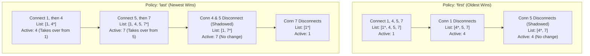

# Multiple Port Providers & Arbitration Policy Specification

## 1. Overview and Problem Statement

In an APX network, multiple connected client nodes may publish a provide port (`P-Port`) with the exact same port signature (matching port name and normalized data type signature). This occurs in several real-world scenarios:

1. **Interactive Debugging, Override & Fault Injection**: A developer connects an external test tool (`apx-node`, `apx-control`, or `apx-log replay`) to override a specific signal produced by an existing ECU node without shutting down the original node.
2. **Duplicate Port Definitions Across Teams**: In large organizations with many developers, multiple nodes may accidentally or intentionally define a provide port with the same signature.
3. **Redundant / Standby Producers**: Two redundant sensor or gateway nodes provide the same signal, where the primary node drives the signal during normal operation and the secondary node automatically takes over if the primary disconnects.
4. **Node Reconnection Races**: A node restarts after a transient network drop and reconnects before its previous session socket has fully timed out on the server.

### 1.1. Historical Context (`v0.2.8` vs. `master`)

* **Legacy `v0.2.8` Behavior ("Accidental Last-Wins")**:
  In `c-apx` `v0.2.8` (`apx_router.c` / `apx_routerPortMapEntry.c`), provide ports for a given port signature were stored in a dynamic array (`providePorts`). Whenever a new provide port attached, the router unconditionally disconnected any existing provider from all matching require ports and connected the newly attached provide port. When a require port attached or its active provider disconnected, the router selected `providePorts[numProvidePorts - 1]` (the most recently connected provider).
  While convenient for ad-hoc debugging overrides, unconditional "last-wins" takeover is undesirable in production environments where the primary provider that connected first must retain ownership unless it disconnects.

* **Current `master` (`v0.3.x`) State**:
  During the `v0.3.x` rewrite, `apx_port_signature_map_entry_t` (`apx_core/include/apx/port_signature_map_entry.h`) introduced a `preferred_provider` pointer alongside a doubly-linked list `adt_list_t provide_ports`. However, the multi-provider lifecycle remains incomplete:
  1. `apx_port_signature_map_insert()` unconditionally passes `is_preferred = true` and connects the new provider to require ports **without** disconnecting the previous `preferred_provider`. Both providers remain in their respective `node_instance->connector_table` arrays and simultaneously overwrite the require port's `.in` file whenever either writes to its `.out` file.
  2. `notify_provide_ports_about_require_port_change()` iterates over all `self->provide_ports` instead of only `self->preferred_provider` when a require port connects, setting `require_port_change_entry->count > 1` and triggering `APX_NOT_IMPLEMENTED_ERROR` in `server.c:501` (`handle_require_ports_connected`).
  3. `apx_port_signature_map_remove()` removes the disconnecting provide port from `entry->provide_ports` but **never updates `entry->preferred_provider`** and never switches to a remaining provider in `entry->provide_ports`.
  4. `apx_node_instance_handle_require_ports_disconnected()` returns `APX_NOT_IMPLEMENTED_ERROR` if `entry->count < -1`.

This specification defines a deterministic, configurable **Multiple Provider Policy** (`"first"` vs. `"last"`), complete provider connect/disconnect state machines, lock-free two-phase routing updates, and full observability in `apx-text-log`, `apx-log`, and `apx-mon` (including `apx-mon routing --multi-provider`).

---

## 2. Server Configuration (`multiple-provider-policy`)

### 2.1. JSON Configuration Schema

The `apx-server` section of `server.json` accepts a `"multiple-provider-policy"` key (with `"multiple_provider_policy"` recognized as a supported alias):

```json
{
    "apx-server": {
        "multiple-provider-policy": "first",
        "apx-cache-enabled": false,
        "apx-cache-path": "",
        "max-num-events": 200
    }
}
```

### 2.2. Policy Semantics

| Policy Value | Enum Constant | Winning Provider | Behavior on New Provider Connect | Behavior on Active Provider Disconnect |
| :--- | :--- | :--- | :--- | :--- |
| `"first"` *(Default)* | `APX_MULTIPLE_PROVIDER_POLICY_FIRST` | Oldest connected provider (`adt_list_first`) | Appended to tail of `provide_ports` as **shadowed**. Active routing is unchanged. | Next oldest provider (`adt_list_first`) becomes `preferred_provider` and takes over routing. |
| `"last"` | `APX_MULTIPLE_PROVIDER_POLICY_LAST` | Newest connected provider (`adt_list_last`) | Appended to tail of `provide_ports` and **takes over** from previous `preferred_provider` (which becomes shadowed). | Previous newest provider (`adt_list_last`) becomes `preferred_provider` and takes over routing. |

> [!NOTE]
> **Why `"first"` is the Default**: In production automotive systems, the primary node providing a signal must not be silently overridden if a secondary or duplicate node connects later. Users and test environments that want `v0.2.8`-style override behavior (e.g., for debugging or `apx-log replay` overrides) can set `"multiple-provider-policy": "last"` in `server.json`.

### 2.3. Validation & Unknown-Key Handling

* Add `"multiple-provider-policy"` and `"multiple_provider_policy"` to `m_apx_server_keys[]` in `app/apx_server/src/server_cfg.c`.
* If `"multiple-provider-policy"` is set to an unrecognized string (neither `"first"` nor `"last"`), `apx_server_check_config_unknown_keys_cb()` / `apx_server_configure()` emits a startup warning to `stderr` (`Warning: Invalid value '<val>' for 'apx-server.multiple-provider-policy' (expected 'first' or 'last'); defaulting to 'first'`) and continues with `APX_MULTIPLE_PROVIDER_POLICY_FIRST`.

---

## 3. Core Routing Architecture & Data Structures

### 3.1. Single Active Provider Invariant

For every port signature entry (`apx_port_signature_map_entry_t`) in the server's `port_signature_map`:

1. **Ordered Provider List (`adt_list_t provide_ports`)**:
   * Stores `apx_port_instance_t *` pointers in strict chronological order of attachment.
   * New providers are always inserted at the tail via `adt_list_insert(&entry->provide_ports, port_instance)`.
   * Disconnecting providers are removed from anywhere in the list via `adt_list_remove(&entry->provide_ports, port_instance)`, preserving the relative chronological order of all remaining providers.
   * `adt_list_first(&entry->provide_ports)` always yields the **oldest** connected provider in $O(1)$ time.
   * `adt_list_last(&entry->provide_ports)` always yields the **newest** connected provider in $O(1)$ time.
2. **Active Provider Pointer (`apx_port_instance_t *preferred_provider`)**:
   * Points to the single active provider for this port signature, or `NULL` when `provide_ports` is empty.
   * Invariant under `APX_MULTIPLE_PROVIDER_POLICY_FIRST`:
     `preferred_provider == (apx_port_instance_t *)adt_list_first(&entry->provide_ports)`
   * Invariant under `APX_MULTIPLE_PROVIDER_POLICY_LAST`:
     `preferred_provider == (apx_port_instance_t *)adt_list_last(&entry->provide_ports)`
3. **Exclusive Connector Table Ownership**:
   * **Only** `preferred_provider` has require port references populated in its `node_instance->connector_table[provide_port_id]`.
   * All other provide ports in `entry->provide_ports` are **shadowed**: their `connector_table[provide_port_id]` is empty (`adt_ary_length == 0`).
   * Because each require port is connected to at most **one** active provider (`preferred_provider`) at any instant, a require port never receives conflicting writes from multiple providers, and its active provider count is always `0` or `1`.
4. **Shadowed Provider Data Readiness**:
   * Even while a provider is shadowed, the server opens and synchronizes its `.out` file as usual (`apx_node_instance_t->out_port_data_file`).
   * Whenever a shadowed provider writes new signal values to its `.out` file, `node_instance.c` updates its local `out_port_data_file` buffer in server memory, then checks `connector_table[provide_port_id]`. Since the connector list is empty, no writes are forwarded to require ports.
   * When the shadowed provider becomes `preferred_provider` (because the active provider disconnected), its latest `.out` port data is already present in `out_port_data_file` and is immediately routed to all require ports' `.in` files.

---

## 4. Provider Arbitration State Machine & Examples

Consider a port signature where four clients connect sequentially with connection IDs `1`, `4`, `5`, and `7`, resulting in `provide_ports = [1, 4, 5, 7]`.



### 4.1. Transition 1: Provide Port Connects (`apx_port_signature_map_insert`)

Let `old_preferred = entry->preferred_provider`. The new `port_instance` is appended to `entry->provide_ports`.

1. **Case 1A: First Provider (`old_preferred == NULL`)** *(Applies to both `"first"` and `"last"`)*
   * `entry->preferred_provider = port_instance`.
   * For every `require_port` in `entry->require_ports`:
     * Record `+1` connection in `provide_port_change_table` for `port_instance` and `+1` in `require_port_change_table` for `require_port`.
   * Outside `global_lock`:
     * Add `require_port` to `port_instance`'s `connector_table`.
     * Copy `port_instance`'s initial `.out` value to each `require_port`'s `.in` file.
     * Update `ProvidePortCount = num_requesters` on `port_instance` and `RequirePortCount = 1` on each `require_port`.

2. **Case 1B: Additional Provider under `"first"` Policy (`old_preferred != NULL`)**
   * `entry->preferred_provider` remains `old_preferred`.
   * `port_instance` rests at the tail of `entry->provide_ports` in shadowed state.
   * **No connector changes** are generated for `old_preferred`, `port_instance`, or `entry->require_ports`.
   * `port_instance`'s `ProvidePortCount` remains `0` (initial zero-initialized value in its node instance).

3. **Case 1C: Additional Provider under `"last"` Policy (`old_preferred != NULL`) — Takeover**
   * `entry->preferred_provider` is updated from `old_preferred` to `port_instance`.
   * If `entry->require_ports` is non-empty:
     * `old_preferred` must be **disconnected** from all `entry->require_ports`.
     * `port_instance` must be **connected** to all `entry->require_ports`.
   * Outside `global_lock`:
     * Lock `old_preferred->parent`'s connector table, remove all `entry->require_ports` from `old_preferred`'s `connector_table`, unlock, and update `old_preferred`'s `ProvidePortCount` to `0`.
     * Lock `port_instance->parent`'s connector table, add all `entry->require_ports` to `port_instance`'s `connector_table`, route `port_instance`'s current `.out` value to each `require_port`'s `.in` file, unlock, and update `port_instance`'s `ProvidePortCount` to `num_requesters`.
     * Emit provider change event: `old_preferred` $\to$ `port_instance`.

### 4.2. Transition 2: Provide Port Disconnects (`apx_port_signature_map_remove`)

Let `was_preferred = (entry->preferred_provider == closing_port)`. Remove `closing_port` from `entry->provide_ports`.

1. **Case 2A: Shadowed Provider Disconnects (`!was_preferred`)**
   * Example: In `[1, 4, 5, 7]`, connections `4` and `5` disconnect while `7` is active (`"last"`) or `1` is active (`"first"`).
   * `entry->preferred_provider` is unchanged.
   * Because `closing_port` was shadowed, its `connector_table` is already empty.
   * **Zero routing changes** or notifications are needed for `entry->require_ports` or `entry->preferred_provider`.

2. **Case 2B: Active Provider Disconnects (`was_preferred`) and No Other Providers Remain**
   * `entry->provide_ports` is now empty $\to$ `entry->preferred_provider = NULL`.
   * For each `require_port` in `entry->require_ports`, record `-1` disconnection of `closing_port`.
   * Outside `global_lock`:
     * Remove `require_port` from `closing_port`'s `connector_table`.
     * Update each surviving `require_port`'s `RequirePortCount` to `0`.

3. **Case 2C: Active Provider Disconnects (`was_preferred`) and Next Provider in List Takes Over**
   * Select `new_preferred` from `entry->provide_ports`:
     * Policy `"first"`: `new_preferred = (apx_port_instance_t *)adt_list_first(&entry->provide_ports)` (e.g., `1` disconnects from `[1, 4, 5, 7]` $\to$ `4` becomes active).
     * Policy `"last"`: `new_preferred = (apx_port_instance_t *)adt_list_last(&entry->provide_ports)` (e.g., `7` disconnects from `[1, 4, 5, 7]` $\to$ `5` becomes active; or if `4` and `5` already disconnected leaving `[1, 7]`, and `7` disconnects $\to$ `1` becomes active).
   * `entry->preferred_provider = new_preferred`.
   * Outside `global_lock`:
     * Remove surviving `require_ports` from `closing_port`'s `connector_table`.
     * Add surviving `require_ports` to `new_preferred`'s `connector_table`.
     * Route `new_preferred`'s current `.out` value to each surviving `require_port`'s `.in` file via `apx_node_instance_route_provide_port_data_to_require_port()`.
     * Update `new_preferred`'s `ProvidePortCount` to `num_surviving_requesters`.
     * Emit provider change event: `closing_port` $\to$ `new_preferred`.

> [!IMPORTANT]
> **Multi-Node Connection Teardown (`detach_all_nodes` in `server_connection.c`)**:
> A single client connection (`apx_server_connection_t`) may host multiple `apx_node_instance_t` instances that provide the same port. When that connection closes, `detach_all_nodes()` detaches all of its nodes inside a single `global_lock` critical section before releasing `global_lock` to process surviving nodes.
> By detaching all nodes belonging to the closing connection from `port_signature_map` **before** selecting `new_preferred` for surviving nodes, a dying node on the same connection will never be transiently selected as `new_preferred` only to be detached on the next loop iteration.

### 4.3. Transition 3: Require Port Connects or Disconnects

* **Require Port Connects**:
  * `notify_provide_ports_about_require_port_change()` in `port_signature_map_entry.c` must **only** connect `require_port` to `self->preferred_provider` (if `self->preferred_provider != NULL`), rather than iterating over `self->provide_ports`.
  * Consequently, `require_port_change_entry->count` is always `1` (when a provider exists) or `0` (when no provider exists).
* **Require Port Disconnects**:
  * `notify_provide_ports_about_require_port_change()` must **only** notify `self->preferred_provider` (if `self->preferred_provider != NULL`), because shadowed providers do not hold `require_port` in their `connector_table`.

---

## 5. Thread Safety & Two-Phase Lock-Free Processing

To comply with the `c-apx` **Deadlock Prevention Rule** (never invoke callbacks or perform file manager writes while holding `server->global_lock`), both provider takeover on connect (under `"last"` policy) and provider switch on disconnect use a two-phase design:

### 5.1. Provider Takeover on Node Attach (`apx_server_insert_node_instance` in `server.c`)

When a new node attaches under `"last"` policy and its provide port takes over from an existing `old_preferred` provider:

1. **Phase 1 (Under `server->global_lock`)**:
   * `apx_port_signature_map_insert()` updates `entry->preferred_provider = new_port`.
   * Records `require_ports` connected to `new_port` in `provide_port_change_table` and `require_port_change_table`.
   * Records any replaced `(old_preferred, require_port)` pairs in a `replaced_provide_ports` change table (or list of provider switch transitions).
2. **Phase 2 (Unlocked — `server->global_lock` released)**:
   * First, process `replaced_provide_ports`:
     * For each replaced `old_preferred`, lock its `node_instance` connector table, remove `require_port` connectors, unlock, update `old_preferred`'s `ProvidePortCount` to `0`, and emit `port_disconnected` events.
   * Second, process `new_port` connections (`handle_provide_ports_connected`):
     * Lock `new_port`'s `node_instance` connector table, insert `require_port` connectors, route `new_port`'s `.out` data to each `require_port`'s `.in` file, unlock, update `new_port`'s `ProvidePortCount`, and emit `provider_changed` / `port_connected` events.

### 5.2. Provider Switch on Connection Detach (`detach_all_nodes` in `server_connection.c`)

When a connection closes and one or more of its provide ports were `preferred_provider`:

1. **Phase 1 (Under `server->global_lock`)**:
   * Detach all `node_instance` objects belonging to the closing connection from `port_signature_map`.
   * For any affected `apx_port_signature_map_entry_t` where the closing connection held `preferred_provider`:
     * Record the disconnection of `closing_port` from surviving `require_ports` (`surviving_requester_changes`).
     * Select `new_preferred` (`adt_list_first` for `"first"` or `adt_list_last` for `"last"`).
     * If `new_preferred != NULL`, record the activation of `new_preferred` to connect to all surviving `require_ports` (`activated_provider_changes`).
2. **Phase 2 (Unlocked — `server->global_lock` released)**:
   * Process `surviving_requester_changes` (disconnect `closing_port`, emit `port_disconnected` events).
   * Process `activated_provider_changes`:
     * For each newly active `new_preferred`, lock its `node_instance` connector table, connect surviving `require_ports`, route `new_preferred`'s current `.out` value to each surviving `require_port`'s `.in` file, unlock, update `new_preferred`'s `ProvidePortCount`, update surviving `require_ports`' `RequirePortCount` to `1`, and emit `provider_changed` / `port_connected` events.

### 5.3. Multi-Provider Disconnect Loop in `node_instance.c`

Although the single-active-provider invariant ensures a require port only has at most one active provider at a time, `apx_node_instance_handle_require_ports_disconnected()` in `apx_core/src/node_instance.c` (line 1078) will also be completed so that `entry->count < -1` iterates cleanly over `apx_port_connector_change_entry_get(entry, i)` rather than returning `APX_NOT_IMPLEMENTED_ERROR`.

---

## 6. Observability, Logging & Diagnostics

When a port's active provider changes from one connection/node to another (either because a new provider took over in `"last"` mode or because the active provider disconnected and the next provider in the list took over), it must be clearly reported across `apx-text-log`, `apx-log`, and `apx-mon`.

### 6.1. Server Event Listener (`apx_server_event_listener_t`)

Add a `provider_changed` callback to `apx_server_event_listener_t` in `apx_core/include/apx/event_listener.h`:

```c
typedef enum apx_provider_change_reason_tag
{
  APX_PROVIDER_CHANGE_DISCONNECT = 0, /* Active provider disconnected; next provider in list became active */
  APX_PROVIDER_CHANGE_TAKEOVER = 1    /* Newer provider connected and took over under 'last' policy */
} apx_provider_change_reason_t;

typedef void (*apx_port_provider_change_event_func_t)(
    void *arg,
    uint32_t old_connection_id,
    struct apx_port_instance_tag *old_provide_port,
    uint32_t new_connection_id,
    struct apx_port_instance_tag *new_provide_port,
    apx_provider_change_reason_t reason);
```

### 6.2. Text Log Extension (`apx_text_log_extension`)

In `extension/apx_text_log_extension/src/server_text_log.c`:
* **Provider Changed (`INFO` level)**:
  Format the log message using the `<conn_id>:<NodeName>/<PortName>` convention matching `apx-mon routing`:
  ```text
  [INFO ] [PORT] Provider changed: 1:NodeA/Port -> 4:NodeB/Port
  ```
* **Individual Route Changes (`DEBUG` level)**:
  Existing `-->` (`port_connected`) and `-!->` (`port_disconnected`) messages continue to log at `DEBUG` level for each affected require port.

### 6.3. Binary Event Stream (`server.log` / `.apxlog` / `apx-log`)

In `extension/apx_monitor_extension/include/apx/extension/log_streamer.h` and `app/apx_log/src/apx_log_event.c`:

* Define event type `APX_LOG_EVENT_PROVIDER_CHANGE = 0x0050u` (`"PROVIDER_CHANGE"`) without incrementing the `.apxlog` / `server.log` format minor version (`v1.0` remains `1.0`):
  * **Event Header**:
    * `connection_id`: `new_connection_id`
    * `object_id`: `new_provide_port_id`
  * **Event Payload**:
    * `old_connection_id` (`uint32_t`, Little-Endian)
    * `old_provide_port_id` (`uint32_t`, Little-Endian)
    * `reason` (`uint8_t`: `0 = DISCONNECT`, `1 = TAKEOVER`)
    * `policy` (`uint8_t`: `0 = FIRST`, `1 = LAST`)
    * `reserved` (`uint16_t`: `0`)
    * `old_node_name` (`String16`)
    * `new_node_name` (`String16`)
    * `port_name` (`String16`)
* **`apx-log print` Output**:
  * Text format:
    ```text
    [+  2.104512s] [seq=18] PROVIDER_CHANGE 1:SensorA/VehicleSpeed -> 4:SensorB/VehicleSpeed
    ```
  * NDJSON (`--json`) format:
    ```json
    {"seq":18,"timestamp_ns":2104512000,"type":"PROVIDER_CHANGE","connection_id":4,"object_id":0,"port_name":"VehicleSpeed","old_connection_id":1,"old_port_id":0,"old_node_name":"SensorA","new_node_name":"SensorB","reason":"DISCONNECT","policy":"first"}
    ```

### 6.4. Diagnostic CLI (`apx-mon` / `diag_dispatcher.c`)

In `extension/apx_monitor_extension/src/diag_dispatcher.c` and `app/apx_mon`:

1. **Shadowed Providers in `apx-mon routing --unconnected` and `apx-mon routing --all`**:
   * In `handle_list_unconnected_ports()` (`diag_dispatcher.c:1407`), any provide port in `entry->provide_ports` where `prov != entry->preferred_provider` is emitted as an unconnected port item with `direction = 1` (`PROVIDE`) and `reason = 2` (`SHADOWED`).
   * In `apx-mon routing --unconnected` and `apx-mon routing --all`, items with `reason == 2` display `(shadowed)` in the `REQUIRER_NODE` column:
     ```text
     PORT_NAME                PROVIDER_NODE        REQUIRER_NODE
     ----------------------------------------------------------------------
     VehicleSpeed             1:EngineController   2:Dashboard
     VehicleSpeed             4:TestOverride       (shadowed)
     BatteryVoltage           1:EngineController   -
     ```
   * In `--json` mode, `reason` is serialized as `"SHADOWED"`.

2. **Multi-Provider Report (`apx-mon routing --multi-provider`)**:
   * Add `--multi-provider` option to `apx-mon routing` to generate a report of all port signatures that currently have more than one provider attached (`num_providers > 1`), regardless of whether any require port is connected.
   * Add diagnostic command `APX_DIAG_CMD_LIST_MULTI_PROVIDERS` (`0x0008u`) in `diag_dispatcher.h` / `diag_dispatcher.c`:
     * Scans `server->port_signature_map.internal_map` under `server->global_lock`.
     * For every entry where `apx_port_signature_map_entry_get_num_providers(entry) > 1`, iterates through `entry->provide_ports` in list order and emits an item containing `node_id`, `port_id`, `is_active` (`prov == entry->preferred_provider ? 1u : 0u`), and `port_name`.
   * **Tabular Output**:
     Displays each multi-provider port and all of its providers in queue order, marking the active provider as `ACTIVE` and shadowed providers as `(shadowed)` (and honoring `--strip-id` if passed):
     ```text
     PORT_NAME                PROVIDER_NODE        STATUS
     ----------------------------------------------------------------------
     VehicleSpeed             1:EngineController   ACTIVE
     VehicleSpeed             4:TestOverride       (shadowed)
     VehicleSpeed             7:SimNode            (shadowed)
     ```
   * **JSON Output (`--json`)**:
     ```json
     [
       {
         "port_name": "VehicleSpeed",
         "node_id": 1,
         "port_id": 0,
         "status": "ACTIVE"
       },
       {
         "port_name": "VehicleSpeed",
         "node_id": 2,
         "port_id": 0,
         "status": "SHADOWED"
       }
     ]
     ```

---

## 7. Implementation Checklist & Affected Files

| Component | Files | Key Changes |
| :--- | :--- | :--- |
| **Server Policy & API** | `apx_core/include/apx/types.h`<br/>`apx_core/include/apx/server.h`<br/>`apx_core/src/server.c` | Define `apx_multiple_provider_policy_t` (`FIRST`, `LAST`). Add `apx_server_set_multiple_provider_policy()` / `apx_server_get_multiple_provider_policy()`. Handle provider takeover in `apx_server_insert_node_instance()`. |
| **Config Loader** | `app/apx_server/src/server_cfg.c`<br/>`example/config/server.json` | Parse `"multiple-provider-policy"` (`"first"` / `"last"`, default `"first"`), validate value with warning on unknown value, register key in `m_apx_server_keys[]`. |
| **Port Signature Map** | `apx_core/include/apx/port_signature_map.h`<br/>`apx_core/src/port_signature_map.c`<br/>`apx_core/include/apx/port_signature_map_entry.h`<br/>`apx_core/src/port_signature_map_entry.c` | Pass policy into `apx_port_signature_map_insert()` / `_remove()`. Maintain `preferred_provider` (`adt_list_first` vs. `adt_list_last`). Fix `notify_provide_ports_about_require_port_change()` to only connect/disconnect `preferred_provider`. |
| **Connection Teardown & Switch** | `apx_core/src/server_connection.c`<br/>`apx_core/src/node_instance.c` | In `detach_all_nodes()`, detach all closing nodes before selecting next `preferred_provider`, then connect newly active providers and route their `.out` values outside `global_lock`. Complete `entry->count < -1` loop in `node_instance.c`. |
| **Logging & Diagnostics** | `apx_core/include/apx/event_listener.h`<br/>`extension/apx_text_log_extension/src/server_text_log.c`<br/>`extension/apx_monitor_extension/include/apx/extension/log_streamer.h`<br/>`extension/apx_monitor_extension/src/log_streamer.c`<br/>`extension/apx_monitor_extension/src/server_monitor.c`<br/>`extension/apx_monitor_extension/include/apx/extension/diag_dispatcher.h`<br/>`extension/apx_monitor_extension/src/diag_dispatcher.c`<br/>`app/apx_log/src/apx_log_event.c`<br/>`app/apx_mon/src/apx_mon_main.c`<br/>`docs/apps/apx_mon.rst` | Emit `provider_changed` event (`[INFO ] [PORT] Provider changed: 1:NodeA/Port -> 4:NodeB/Port`). Stream `APX_LOG_EVENT_PROVIDER_CHANGE` (`0x0050`) to `.apxlog`. Display `(shadowed)` in `apx-mon routing --unconnected` / `--all`, and implement `apx-mon routing --multi-provider`. |
| **Tests** | `apx_core/test/testsuite_port_signature_map.c`<br/>`apx_core/test/testsuite_server.c`<br/>`app/apx_server/test/testsuite_server_cfg.c`<br/>`tests/test_multiple_providers.py` | Unit tests for `[1, 4, 5, 7]` connect/disconnect orderings under both `"first"` and `"last"` policies, config parsing, and end-to-end `pytest` tests including `apx-mon routing --multi-provider`. |
