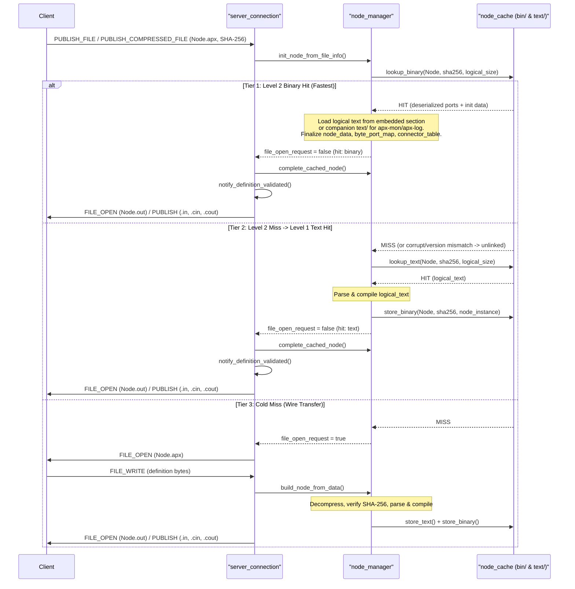
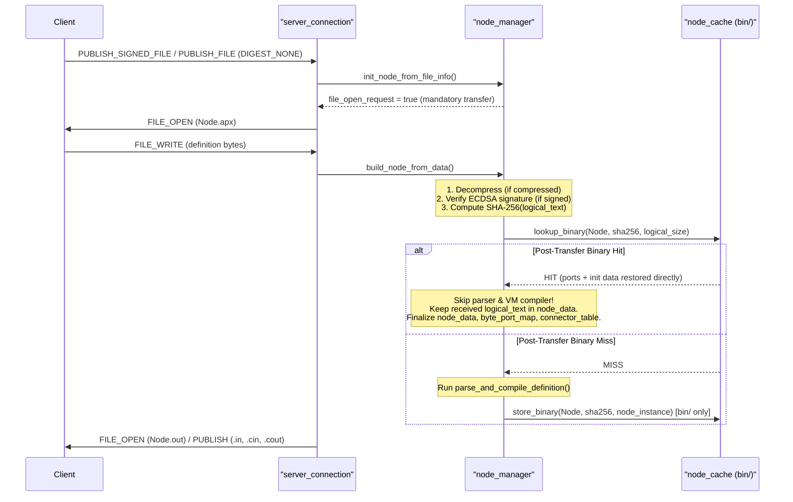

# Server Level 2 Binary Node Definition Cache (`.apxc`) Specification

## 1. Overview and Motivation

Level 1 caching ([`design/node_definition_cache_spec.md`](node_definition_cache_spec.md)) eliminates network transfer and zlib decompression of unchanged `.apx` definitions on reconnect by caching the logical `.apx` text under `<cache_path>/text/`. However, on every Level 1 hit (and on every signed or `RMF_DIGEST_TYPE_NONE` connection), `apx-server` still performs the full CPU-bound compilation pipeline:

1. Lexical scanning and IDL parsing (`apx_parser_parse_bstr()`).
2. Type expansion and semantic resolution (`apx_node_finalize()`).
3. VM 2.1 bytecode compilation for every provide and require port (`apx_compiler_compile_port()`).
4. VM execution to serialize default/initial port values (`apx_vm_pack_value()`).
5. Canonical port signature construction (`apx_port_instance_create_port_signature()`).

This specification defines **Phase 2 (Level 2 Binary Cache, `.apxc`)** for Backlog item 14: a portable, versioned, integrity-verified binary cache stored under `<cache_path>/bin/`. On a Level 2 hit:

* **Unsigned `RMF_DIGEST_TYPE_SHA256` publications** (plain or compressed) bypass **both** wire transfer and the entire parse/compile pipeline.
* **Cryptographically signed publications** (`PUBLISH_SIGNED_FILE`, `PUBLISH_SIGNED_COMPRESSED_FILE`) and **unsigned `RMF_DIGEST_TYPE_NONE` publications** still transfer over the wire (and verify signatures when signed), then hash the logical definition and hit `.apxc` **post-transfer** to bypass parsing and VM compilation.

---

## 2. Runtime State Analysis (What `apx-server` Actually Needs)

An audit of `apx_node_instance_t` (`apx_core/include/apx/node_instance.h`), `apx_port_instance_t` (`apx_core/include/apx/port_instance.h`), `apx_server_t`, and `extension/apx_monitor_extension/` reveals exactly which compiled artifacts are consumed at runtime in `APX_SERVER_MODE`.

### 2.1. Field-by-Field Classification

| Runtime Field / Structure | Used in `APX_SERVER_MODE`? | Consumers | Level 2 Handling |
| :--- | :---: | :--- | :--- |
| `node_instance->name` | **Yes** | Node map, routing, logging, `apx-mon` | Stored in `.apxc` header and cross-checked against `rmf_file_info` |
| `major_version`, `minor_version` | **Yes** | `has_provide_port_count_data()` / `has_require_port_count_data()` (`>= 1.3` enables `.cout`/`.cin`) | Stored in `.apxc` header (`idl_major`, `idl_minor`) |
| `num_provide_ports`, `num_require_ports` | **Yes** | Port arrays, `.cout`/`.cin` sizes, connector table | Stored in `.apxc` header |
| `port->name` | **Yes** | `apx_node_instance_find_port_by_name()`, `apx-mon` watches/diagnostics | Stored in Port Descriptor sections |
| `port->port_signature` | **Yes** | `apx_port_signature_map` port matching and provider routing | Stored in Port Descriptor sections |
| `port->data_offset`, `port->data_size` | **Yes** | `byte_port_map`, live data routing, `apx-mon` watches | Stored in Port Descriptor sections |
| `port->element_size`, `port->queue_length` | **Yes** | Routing checks (`queue_length == 0`) & future queued-port routing | Stored in Port Descriptor sections |
| `port->has_dynamic_data` | **Yes** | `apx_port_instance_get_port_signature()` & future dynamic-array routing | Stored in Port Descriptor sections (`port_flags`) |
| `provide_port_init_data` (`size` bytes) | **Yes** | Copied into `node_data->provide_port_data` | Stored in Init Data section |
| `require_port_init_data` (`size` bytes) | **Yes** | Copied into `node_data->require_port_data` | Stored in Init Data section |
| `node_data->definition_data` | **Yes** (`apx-mon` / `apx-log`) | `server_monitor.c:1026`, `log_streamer.c:1004,1055`, `diag_dispatcher.c:1848` | See §2.3 (Critical Finding #2) |
| `node_data` port data & count buffers | **Yes** | Live `.out`/`.in`/`.cout`/`.cin` state | **Derived** via `apx_node_instance_finalize_node_data()` |
| `provide_byte_port_map` | **Yes** | Offset-to-port lookup during `.out` writes | **Derived** via `apx_node_instance_create_byte_port_map()` |
| `connector_table` | **Yes** | Active provide-to-require routing table | **Derived** via `apx_node_instance_build_connector_table()` |
| `port->pack_program`, `port->unpack_program` | **No** (runtime) | Used only by `apx_client_t` (`client.c:634,704`) and compile-time init packing (`node_manager.c:927`) | Stored in optional VM Program sections; skipped on server load (see §2.2) |
| `data_elements`, `effective_data_element` | **No** (runtime) | Used only during build to generate `port_signature` | **Not serialized** in v1.0 (section type reserved for future use) |
| `computation_lists`, `port->computation_list` | **No** (runtime) | Not read by server, `apx-mon`, or `apx-node` | **Not serialized** in v1.0 (section type reserved for future use) |

### 2.2. Critical Finding #1: VM Bytecode Programs (`pack_program` / `unpack_program`)

`apx-server` never executes VM bytecode once `build_node_instance()` finishes — live routing copies raw byte slices using `(data_offset, data_size, queue_length, has_dynamic_data)` and matches ports by `port_signature`. However, `build_node_instance()` **already** compiles `pack_program` and `unpack_program` on a cache miss in order to evaluate initial values.

To support future client-side caching (`apx-node`, `apx-mon`, offline tools) without changing the `.apxc` format, this specification places VM bytecode in **dedicated optional sections** (`APXC_SEC_PROVIDE_VM_PROGS`, `APXC_SEC_REQUIRE_VM_PROGS`):

* **On write**: `apx-server` serializes the already-compiled `pack_program` and `unpack_program` blobs (~8–32 bytes per port; ~10 KB for a 500-port node) into the VM program sections and sets `APXC_FLAG_HAS_VM_PROGRAMS`.
* **On read in `APX_SERVER_MODE`**: The server passes `load_vm_programs = false` to the decoder, skipping those sections in O(1) via the section directory and leaving `port->pack_program = NULL` / `port->unpack_program = NULL`. This avoids `num_provide_ports + 2 * num_require_ports` heap allocations per connected node on the server while keeping `.apxc` files universally usable by future client loaders (`load_vm_programs = true`).

### 2.3. Critical Finding #2: Logical `.apx` Text for `apx-mon` and `apx-log`

Three call sites in `extension/apx_monitor_extension/` read `apx_node_instance_get_definition_data(node)` and `apx_node_instance_get_definition_size(node)`:

1. `server_monitor.c` (`on_definition_validated()`): Streams logical `.apx` `FILE_PUBLISH`, `FILE_OPEN`, and `FILE_WRITE` events to active `apx-log` sessions whenever any node reaches `APX_DATA_STATE_SYNCHRONIZED`.
2. `log_streamer.c` (initial snapshot): Replays logical `.apx` definitions to newly attached `apx-mon` / `apx-log` sessions so monitors can decode port payloads.
3. `diag_dispatcher.c` (`APX_DIAG_CMD_GET_NODE_DEFINITION`): Serves raw `.apx` text on demand (returning `APX_NOT_FOUND_ERROR` if `definition == NULL || out_size == 0`).

Additionally, `diag_dispatcher.c` runs while holding `server->global_lock`, so **lazy disk I/O inside diagnostic callbacks is forbidden** (violates the "Zero Disk I/O Under `server->global_lock`" rule).

How `node_data->definition_data` is satisfied on a Level 2 hit depends on the hit path:

* **Post-transfer Level 2 hit** (signed nodes and `RMF_DIGEST_TYPE_NONE` clients): The server has **already received** (and decompressed, if compressed) the full logical `.apx` text over the wire. It simply stores that logical text in `node_data` as usual and uses `.apxc` to skip parsing and compilation. Zero extra disk I/O is needed, and signed `.apx` text is never written to `<cache_path>/text/`.
* **Pre-transfer Level 2 hit** (unsigned `RMF_DIGEST_TYPE_SHA256`, and future Backlog Item 25 signed `SHA-256`): Wire transfer was skipped. Three strategies exist for supplying `definition_data`:
  * **Option T1 (Companion Level 1 `text/` file)**: On an unsigned SHA-256 miss at `level == 2`, store both `text/<node>_<sha256>.apx` and `bin/<node>_<sha256>.apxc`. On a pre-transfer Level 2 hit, read `text/<node>_<sha256>.apx` into `node_data->definition_data` (fast page-cache read, zero zlib CPU). Keeping `text/` also provides **zero-wire-transfer resilience on server upgrades**: if a newer `apx-server` bumps `.apxc` `format_major` or `compiler_abi`, the server misses `bin/`, hits `text/`, recompiles locally, and regenerates `bin/` without asking any ECU to re-transmit its `.apx` file.
  * **Option T2 (Embedded zlib-compressed `APXC_SEC_DEF_TEXT` section)**: Embed zlib-compressed logical `.apx` text inside `.apxc` (~5x–10x smaller than raw text, single file open per hit, fully self-contained for offline pre-warming). Costs ~100–200 µs of zlib decompression on hit and duplicates text if `text/` is also retained.
  * **Option T3 (Hybrid — Recommended)**:
    1. The `.apxc` format defines an **optional** `APXC_SEC_DEF_TEXT` section (`0x0007`, supporting raw or RFC 1950 zlib-compressed text).
    2. By default, `apx-server` writes **Option T1** (stores companion `text/` for unsigned SHA-256, omits `APXC_SEC_DEF_TEXT` in `bin/` to avoid duplicating bytes on flash and to avoid storing signed `.apx` text in `bin/`).
    3. On a pre-transfer Level 2 hit, `apx-server` populates `node_data->definition_data` in priority order:
       1. If `.apxc` contains `APXC_SEC_DEF_TEXT` (e.g., an offline pre-warmed self-contained `.apxc`): extract/decompress it directly into `node_data`.
       2. Else if companion `text/<node>_<sha256>.apx` exists and validates: load it into `node_data`.
       3. Else (pre-warmed minimal `.apxc` without `text/`): leave `node_data->definition_data = NULL`, `definition_data_size = 0u`. Routing works normally, and `server_monitor.c:on_definition_validated()` is hardened to guard `if (data != NULL && logical_info.size > 0u)` before enqueueing `FILE_WRITE`.

---

## 3. Binary File Format Specification (`.apxc` v1.0)

### 3.1. General Encoding Rules

* **Byte order**: All multi-byte integers (`uint16_t`, `uint32_t`) are strictly **little-endian**, encoded and decoded explicitly with `cutil/pack.h` (`cutil_pack_u16_le`, `cutil_pack_u32_le`, `cutil_unpack_u16_le`, `cutil_unpack_u32_le`). Native C structs are **never** written directly to disk.
* **No implicit padding**: Every field offset is explicit and unaligned-safe, eliminating compiler/ABI/architecture differences across x86_64, ARM32, ARM64, Linux, and Windows.
* **String encoding**: Length-prefixed byte arrays (`uint16_t` length followed by raw UTF-8/ASCII bytes with **no** trailing NUL on disk). Decoders MUST reject embedded NUL bytes (`0x00`) and allocate `len + 1` bytes with a trailing `'\0'` in RAM.

### 3.2. High-Level File Layout

```text
+---------------------------------------------------------------+ 0x00
| Fixed File Header (72 bytes)                                  |
+---------------------------------------------------------------+ 0x48
| Node Name (node_name_len bytes, ASCII/UTF-8, no NUL)          |
+---------------------------------------------------------------+ 0x48 + node_name_len
| Section Directory (section_count * 12 bytes)                  |
+---------------------------------------------------------------+ dir_end
| Section 0 Payload                                             |
| Section 1 Payload                                             |
| ...                                                           |
| Section (section_count - 1) Payload                           |
+---------------------------------------------------------------+ total_file_size - 32
| Whole-File Integrity Trailer: SHA-256 (32 bytes)              |
+---------------------------------------------------------------+ total_file_size
```

### 3.3. Fixed File Header (72 Bytes)

| Offset | Size | Field | Type | Description |
| :--- | :---: | :--- | :--- | :--- |
| `0x00` | 4 | `magic` | `uint8_t[4]` | Magic bytes: `0x00, 0x41, 0x50, 0x58` (`"\0APX"`). |
| `0x04` | 1 | `format_major` | `uint8_t` | `.apxc` container major version (`1`). Readers MUST reject any mismatch. |
| `0x05` | 1 | `format_minor` | `uint8_t` | `.apxc` container minor version (`0`). Minor increments add optional sections only. |
| `0x06` | 1 | `vm_major` | `uint8_t` | APX VM major version (`2`, matching `APX_VM_HEADER_VERSION_MAJOR - '0'`). |
| `0x07` | 1 | `vm_minor` | `uint8_t` | APX VM minor version (`1`, matching `APX_VM_HEADER_VERSION_MINOR - '0'`). |
| `0x08` | 2 | `compiler_abi` | `uint16_t` LE | Compiler/routing compatibility revision (initially `1`). Bumped whenever `port_signature` normalization rules, port layout rules, or init-data packing semantics change (e.g., future dynamic-array capacity matching). |
| `0x0A` | 2 | `flags` | `uint16_t` LE | Bitfield: bit 0 (`0x0001`) = `APXC_FLAG_HAS_VM_PROGRAMS`, bit 1 (`0x0002`) = `APXC_FLAG_HAS_DEF_TEXT`. Bits 2–15 reserved (`0`). |
| `0x0C` | 2 | `section_count` | `uint16_t` LE | Number of entries in the Section Directory (`0..APXC_MAX_SECTIONS`, where `APXC_MAX_SECTIONS = 16`). |
| `0x0E` | 2 | `node_name_len` | `uint16_t` LE | Length of node name immediately following the fixed header (`1..RMF_MAX_FILE_NAME_SIZE`). |
| `0x10` | 4 | `total_file_size` | `uint32_t` LE | Exact total byte length of the `.apxc` file (header + node name + directory + sections + 32-byte trailer). |
| `0x14` | 4 | `logical_def_size` | `uint32_t` LE | Exact byte length of the logical uncompressed `.apx` definition (`1..APX_MAX_FILE_SIZE`). |
| `0x18` | 32 | `definition_sha256` | `uint8_t[32]` | SHA-256 digest of the logical uncompressed `.apx` definition bytes. |
| `0x38` | 2 | `idl_major` | `uint16_t` LE | APX IDL major version parsed from `APX/M.m` (e.g., `1`). |
| `0x3A` | 2 | `idl_minor` | `uint16_t` LE | APX IDL minor version parsed from `APX/M.m` (e.g., `2` or `3`). Drives `.cin`/`.cout` publication. |
| `0x3C` | 4 | `num_provide_ports` | `uint32_t` LE | Number of provide ports on the node (`0..APXC_MAX_PORTS`). |
| `0x40` | 4 | `num_require_ports` | `uint32_t` LE | Number of require ports on the node (`0..APXC_MAX_PORTS`). |
| `0x44` | 4 | `reserved` | `uint32_t` LE | Reserved for future use; MUST be `0` in v1.0. |

### 3.4. Section Directory (`section_count * 12` Bytes)

Immediately following the `node_name_len` bytes of `node_name`, each 12-byte directory entry describes one section:

| Offset | Size | Field | Type | Description |
| :--- | :---: | :--- | :--- | :--- |
| `+0x00` | 2 | `section_type` | `uint16_t` LE | Section type identifier (table below). |
| `+0x02` | 2 | `section_flags` | `uint16_t` LE | Section-specific flags (`0` unless specified). |
| `+0x04` | 4 | `section_offset` | `uint32_t` LE | Byte offset of section payload from start of file (`0x00`). |
| `+0x08` | 4 | `section_size` | `uint32_t` LE | Byte length of section payload. |

#### Defined Section Types

| Type ID | Constant | Presence | Description |
| :--- | :--- | :--- | :--- |
| `0x0001` | `APXC_SEC_PROVIDE_PORTS` | Required iff `num_provide_ports > 0` | Array of `num_provide_ports` provide port descriptors. |
| `0x0002` | `APXC_SEC_REQUIRE_PORTS` | Required iff `num_require_ports > 0` | Array of `num_require_ports` require port descriptors. |
| `0x0003` | `APXC_SEC_PROVIDE_INIT_DATA` | Required iff `num_provide_ports > 0` | Raw binary initial buffer for `.out` (`provide_port_init_data`). |
| `0x0004` | `APXC_SEC_REQUIRE_INIT_DATA` | Required iff `num_require_ports > 0` | Raw binary initial buffer for `.in` (`require_port_init_data`). |
| `0x0005` | `APXC_SEC_PROVIDE_VM_PROGS` | Optional (iff `HAS_VM_PROGRAMS` and `num_provide_ports > 0`) | Compiled VM 2.1 `pack_program` bytecode per provide port. |
| `0x0006` | `APXC_SEC_REQUIRE_VM_PROGS` | Optional (iff `HAS_VM_PROGRAMS` and `num_require_ports > 0`) | Compiled VM 2.1 `pack_program` and `unpack_program` bytecode per require port. |
| `0x0007` | `APXC_SEC_DEF_TEXT` | Optional (iff `HAS_DEF_TEXT`) | Logical `.apx` definition text (`section_flags`: `0` = raw, `1` = RFC 1950 zlib-compressed). |
| `0x0008..0xFFFF` | *(Reserved)* | Optional | Reserved for future optional sections (e.g., `DATA_ELEMENTS`, `COMPUTATION_LISTS`). Unknown types are skipped safely in v1.x readers. |

### 3.5. Section Payload Layouts

#### `APXC_SEC_PROVIDE_PORTS` (`0x0001`) and `APXC_SEC_REQUIRE_PORTS` (`0x0002`)

Contains `N` sequential variable-length port descriptor records corresponding to `port_id = 0 .. N-1`:

| Offset | Size | Field | Type | Description |
| :--- | :---: | :--- | :--- | :--- |
| `+0x00` | 4 | `data_offset` | `uint32_t` LE | Byte offset of this port within `.out` (provide) or `.in` (require). |
| `+0x04` | 4 | `data_size` | `uint32_t` LE | Byte length of this port slot (`> 0`). |
| `+0x08` | 4 | `element_size` | `uint32_t` LE | Element byte length when `queue_length > 0`, otherwise `0`. |
| `+0x0C` | 4 | `queue_length` | `uint32_t` LE | Queue capacity (`0` for non-queued ports). |
| `+0x10` | 1 | `port_flags` | `uint8_t` | Bit 0 (`0x01`) = `has_dynamic_data`. Bits 1–7 reserved (`0`). |
| `+0x11` | 1 | `reserved` | `uint8_t` | Must be `0`. |
| `+0x12` | 2 | `name_len` | `uint16_t` LE | Length of port name (`> 0`). |
| `+0x14` | 2 | `sig_len` | `uint16_t` LE | Length of canonical `port_signature` string (`> 0`, e.g., `"PortName"S`). |
| `+0x16` | `name_len` | `name` | `uint8_t[]` | Port name bytes (no NUL). |
| `+0x16 + name_len` | `sig_len` | `port_signature` | `uint8_t[]` | Canonical port signature string bytes (no NUL). |

#### `APXC_SEC_PROVIDE_INIT_DATA` (`0x0003`) and `APXC_SEC_REQUIRE_INIT_DATA` (`0x0004`)

Raw byte array containing the exact pre-packed initial data buffer for `.out` or `.in`. Its `section_size` MUST exactly equal the sum of `data_size` across all provide (or require) ports.

#### `APXC_SEC_PROVIDE_VM_PROGS` (`0x0005`)

Contains `num_provide_ports` sequential entries:

```text
[uint32_t LE pack_prog_len][uint8_t pack_prog_bytes[pack_prog_len]]
```

Each `pack_prog_bytes` blob is the verbatim `apx_program_t` byte buffer (including its VM 2.1 program header).

#### `APXC_SEC_REQUIRE_VM_PROGS` (`0x0006`)

Contains `num_require_ports` sequential entries:

```text
[uint32_t LE pack_prog_len][uint8_t pack_prog_bytes[pack_prog_len]]
[uint32_t LE unpack_prog_len][uint8_t unpack_prog_bytes[unpack_prog_len]]
```

#### `APXC_SEC_DEF_TEXT` (`0x0007`, Optional)

* When `section_flags == 0x0000`: Raw logical `.apx` bytes (`section_size == header.logical_def_size`).
* When `section_flags == 0x0001`: RFC 1950 zlib-compressed logical `.apx` bytes (decompressed with `apx_decompress()` using `max_size = header.logical_def_size`).
* In both cases, decoded bytes MUST verify `SHA-256(decoded) == header.definition_sha256` before being accepted.

### 3.6. Whole-File Integrity Trailer (32 Bytes)

The final 32 bytes of every `.apxc` file (`[total_file_size - 32, total_file_size)`) hold:

```text
file_sha256 = SHA-256(file_bytes[0 .. total_file_size - 32))
```

Using SHA-256 reuses `apx_crypto_sha256()` (already compiled into `apx_core`, zero new dependencies), executes in ~20–40 µs on a typical 20 KB `.apxc` file, and provides strong detection of flash bit-rot, truncated writes, and accidental tampering anywhere in the file.

---

## 4. Untrusted-Input Validation Rules (Decoder Safety)

Every `.apxc` file read from disk MUST be treated as untrusted input. A corrupted, truncated, version-mismatched, or maliciously crafted `.apxc` file must **never** crash, leak memory, trigger integer overflow, or cause spurious client rejection.

The decoder (`apx_node_cache_decode_binary()`) enforces these checks in strict order:

1. **Filesystem safety**: Open with `O_RDONLY | O_NOFOLLOW` + `fstat()` verifying `S_ISREG` and `104 <= file_size <= APXC_MAX_FILE_SIZE` (16 MiB cap) via a private cache-file read helper in `node_cache.c`.
2. **Whole-file integrity first**: Check `header.total_file_size == actual_file_size`, then compute and verify the 32-byte `file_sha256` trailer **before** parsing any variable-length field or allocating node structures.
3. **Header & version compatibility**:
   * `magic == "\0APX"` (else `APX_INVALID_HEADER_ERROR` -> corruption).
   * `format_major == 1`, `vm_major == 2`, `vm_minor == 1`, `compiler_abi == APXC_COMPILER_ABI_VERSION` (else `APX_VERSION_ERROR` -> version mismatch; unlink and regenerate).
   * `reserved == 0`, unknown `flags` bits `== 0`, `section_count <= APXC_MAX_SECTIONS`.
4. **Identity binding**:
   * `memcmp(header.definition_sha256, expected_sha256, 32) == 0`.
   * `header.logical_def_size == expected_logical_size` (and `1 <= logical_def_size <= APX_MAX_FILE_SIZE`).
   * `node_name_len == strlen(expected_node_name)` and `memcmp(node_name, expected_node_name, node_name_len) == 0`.
5. **Resource caps**:
   * `num_provide_ports <= APXC_MAX_PORTS` and `num_require_ports <= APXC_MAX_PORTS` (e.g., `65535u`).
6. **Section directory bounds**:
   * Directory end `dir_end = 72 + node_name_len + section_count * 12` MUST satisfy `dir_end <= total_file_size - 32`.
   * Every section's `[section_offset, section_offset + section_size)` MUST lie within `[dir_end, total_file_size - 32)` using overflow-safe subtraction (`section_offset <= payload_end && section_size <= payload_end - section_offset`).
   * No duplicate section types; required sections MUST be present when their corresponding port count is non-zero.
7. **Port layout & init-data consistency**:
   * For both provide and require port tables, `data_size > 0`, `data_offset` strictly equals the running byte offset (`running_offset += data_size`, overflow-checked against `APX_MAX_FILE_SIZE`).
   * Final `running_offset` MUST equal the corresponding `INIT_DATA` section size.
   * `name_len > 0`, `sig_len > 0`, no embedded `'\0'` bytes in `name` or `port_signature`.
   * If `queue_length > 0`, `element_size > 0`.
   * Decoder cursor at end of port loop MUST equal `section_size` exactly (no trailing garbage).
8. **Fallback on any error**: Best-effort `unlink()` the bad `.apxc` (unless `read_only`), increment `bin_version_mismatches` or `bin_corruptions`, log a `WARNING`, and fall back transparently to Level 1 `text/` or wire transfer (or full parse/compile on the post-transfer path).

---

## 5. Cache Hierarchy, Tier Resolution, and Security Flows

### 5.1. Behavior Matrix by Cache Level and Publication Type

| Publication Type | `level = 0` (Off) | `level = 1` (Text) | `level = 2` (Binary + Text) |
| :--- | :--- | :--- | :--- |
| **Unsigned `SHA256`** (plain or compressed) | Wire -> compile | L1 `text/` hit (skip wire) -> compile; on miss: wire -> compile -> store `text/` | **L2 `bin/` hit** (skip wire + compile) -> else **L1 `text/` hit** (skip wire) -> compile -> store `bin/` -> else wire -> compile -> store `text/` + `bin/` |
| **Unsigned `DIGEST_NONE`** | Wire -> compile | Wire -> compile (no cache read/write) | Wire -> compute SHA-256 -> **post-transfer L2 `bin/` hit** (skip compile) -> else compile -> store `bin/` only (no `text/`) |
| **Signed `ECDSA P-256`** (plain or compressed, current RMFP 1.1) | Wire -> verify -> compile | Wire -> verify -> compile (no cache read/write) | Wire -> decompress -> **verify signature** -> compute SHA-256 -> **post-transfer L2 `bin/` hit** (skip compile) -> else compile -> store `bin/` only (no `text/`) |
| **Signed `ECDSA P-256` + `SHA256`** (future Backlog Item 25) | Wire -> verify -> compile | Pre-transfer verify -> L1 `text/` hit -> compile | Pre-transfer verify -> **L2 `bin/` hit** -> else L1 `text/` hit -> else wire |
| **`RMF_DIGEST_TYPE_SHA1`** | Reject (`APX_UNSUPPORTED_ERROR`) | Reject (`APX_UNSUPPORTED_ERROR`) | Reject (`APX_UNSUPPORTED_ERROR`) |

### 5.2. Sequence Flows

#### Flow A: Unsigned `RMF_DIGEST_TYPE_SHA256` at `level = 2`



#### Flow B: Signed Node & Unsigned `DIGEST_NONE` at `level = 2` (Post-Transfer Acceleration)



---

## 6. Storage Layout, Locking, Eviction, and Cache Invalidation

### 6.1. Directory Layout

```text
<cache_path>/
├── .lock                                       # Exclusive OS lock (flock / LockFileEx) with holder PID
├── text/                                       # Level 1 logical .apx text cache
│   └── <node_name>_<64-char-sha256>.apx
└── bin/                                        # Level 2 compiled .apxc binary cache
    ├── .format_version                         # Binary format/VM/ABI stamp (e.g., "1/vm2.1/abi1\n")
    └── <node_name>_<64-char-sha256>.apxc
```

* **Filename convention**: `<node_name>_<64-char-lowercase-sha256>.apxc` (matching Level 1's `<node_name>_<sha256>.apx` and using the exact same `is_safe_node_name()` sanitization).
* **Atomic writes**: Identical to Level 1 — skip redundant writes if `<final_path>` already exists, write to `<final_path>.tmp.<pid>.<seq>`, `cutil_fsync_file()`, `fclose()`, and `cutil_file_replace_atomic()`.

### 6.2. Startup Directory Probing, Exclusive Lock, Format Version Stamp, and Pre-Validation (`level = 2`)

In `apx_node_cache_configure()` (called from `apx_server_configure()` **before** extensions are registered and before the socket extension opens listening sockets):

1. When `level == APX_CACHE_LEVEL_BINARY`:
   * Ensure both `<cache_path>/text` and `<cache_path>/bin` exist and are readable.
   * If `<cache_path>/bin` cannot be created or read, log a warning and degrade gracefully to `APX_CACHE_LEVEL_TEXT` (if `text/` is accessible) or `APX_CACHE_LEVEL_OFF` (if neither is accessible).
   * Probe writability of both `text/` and `bin/`. If either is readable-but-not-writable, enter **Option P1 read-only mode** (`read_only = true`): both `lookup_binary()` and `lookup_text()` serve pre-existing valid entries while skipping `.lock`, `.format_version` sweeping, orphan cleanup, `mtime` refresh, stores, unlinks, and eviction.
   * When writable, acquire the single root-level `<cache_path>/.lock` once — protecting both `text/` and `bin/` against accidental multi-server sharing.
   * Check `<cache_path>/bin/.format_version` against the current stamp string (`"<format_major>/vm<vm_major>.<vm_minor>/abi<compiler_abi>\n"`, e.g. `"1/vm2.1/abi1\n"`):
     * **Missing or mismatched**: Sweep and `unlink()` any stale `*.apxc` files in `bin/` (leaving `text/` untouched), atomically write the new `.format_version` stamp, and emit an informational summary when stale files were cleared (e.g., `"Binary cache format changed; cleared N incompatible .apxc files (Level 1 text cache preserved)"`).
   * **Startup Cache Pre-Validation & Hygiene Pass** (runs while writable, before listening sockets bind — utilizing idle boot time while the network stack starts):
     * **Orphan `*.tmp.*` sweep**: In both `text/` and `bin/`, unlink any leftover `*.tmp.*` temporary files from prior power losses (safe because `<cache_path>/.lock` guarantees exclusive ownership).
     * **Level 2 `.apxc` pre-validation**: For each `*.apxc` in `bin/`, verify regular-file status, `total_file_size`, 32-byte whole-file SHA-256 trailer, magic, format/VM/ABI version, filename-vs-header `node_name` and `definition_sha256` match, and section directory bounds. Immediately `unlink()` any invalid or corrupt `.apxc` file and log a single summary warning if any were removed.
     * **Page-cache warmup & high-water `mtime` discovery**: Reading valid `.apxc` files during this startup pass pulls them into the OS page cache ahead of the initial ECU connect burst, and simultaneously computes `max_existing_mtime` across `text/` and `bin/` for the monotonic high-water clock (§6.3).
     * **No eager recompilation of `text/`**: Missing `.apxc` files are generated lazily when a node actually connects, avoiding wasted CPU/flash writes on historical versions in `text/` that may never reconnect.
     * **Runtime validation remains mandatory**: Startup pre-validation is a hygiene and warmup pass, **not** a replacement for §4; `apx_node_cache_decode_binary()` always performs full validation on every `lookup_binary()` to guard against post-startup file modification (TOCTOU) and read-only mounts.

### 6.3. Coordinated Eviction (`max-versions-per-node` & `max-size-mb`)

With both `text/` and `bin/` active, eviction operates on **logical cache versions** keyed by `(node_name, sha256)` rather than treating `.apx` and `.apxc` as competing independent files:

1. Acquire `node_cache->prune_lock` on store.
2. Scan `text/` (valid `*.apx` entries) and `bin/` (valid `*.apxc` entries, ignoring `.format_version` and `*.tmp.*`), merging entries that share the same `(node_name, sha256)` into a single `prune_version_t` record with:
   * `text_size`, `bin_size`, `combined_size = text_size + bin_size`
   * `effective_mtime = max(text_mtime, bin_mtime)` (so a Level 2 hit that refreshes `.apxc`'s `mtime` keeps its paired `.apx` alive too!)
3. **Per-node version cap (`max-versions-per-node`)**: Sort versions matching `node_name` by ascending `effective_mtime`. Evict oldest versions (unlinking both `.apx` and `.apxc` if present, never evicting the just-stored version) until version count `<= max_versions_per_node`.
4. **Global size cap (`max-size-mb`)**: Sum `combined_size` across all remaining versions in `text/` + `bin/`. If `total_bytes > max_size_bytes`, sort remaining versions by ascending `effective_mtime` and evict oldest versions (both `.apx` and `.apxc`) until `total_bytes <= max_size_bytes`.
5. **Throttled Monotonic High-Water `mtime` (Clock-Skew-Safe LRU)**:
   * Embedded Linux targets frequently lack a battery-backed RTC and reset their system clock to the image build date on every boot (or jump forward later once NTP syncs). Naive wall-clock `mtime` would make newly written files after a reboot look *older* than stale files from an earlier boot.
   * To make LRU work reliably out of the box with **no extra config option** and **no extra metadata file**:
     1. At startup (`apx_node_cache_configure()`), scan `text/` and `bin/` once to find `max_existing_mtime` across cached entries, set `logical_base_sec = max(time(NULL), max_existing_mtime + 1)`, and capture `boot_mono_sec = monotonic_now_sec()` (`CLOCK_MONOTONIC` on POSIX; `GetTickCount64() / 1000` on Windows).
     2. Whenever an LRU timestamp is needed, compute:
        `effective_now = max(time(NULL), logical_base_sec + (monotonic_now_sec() - boot_mono_sec))`
        (advancing `logical_base_sec` if `time(NULL)` jumps forward on NTP sync, so `effective_now` never moves backward).
     3. **On store**: if the newly created file's OS `mtime < effective_now`, explicitly set its `mtime` to `effective_now` via `cutil_file_set_mtime()`.
     4. **On hit**: if `effective_now - file_mtime >= 60` seconds (`APX_CACHE_MTIME_REFRESH_INTERVAL_SEC`), update the file's `mtime` to `effective_now` via `cutil_file_set_mtime()`.
   * On hosts with a working RTC/NTP, `effective_now == time(NULL)` (real wall-clock timestamps). On boards with resetting clocks, every boot's stores and hits stay strictly newer than prior boots across arbitrary reboots. Setting `max-versions-per-node: 0` and `max-size-mb: 0` continues to disable eviction and `mtime` touches completely.

### 6.4. Cache Invalidation Summary

Because the cache is content-addressable with no external index database, every invalidation case is deterministic and self-healing:

| Trigger | Scope | Mechanism |
| :--- | :--- | :--- |
| **Node `.apx` changed** (ECU flash / edit) | Single node | Automatic miss via new `SHA-256`; old versions age out via paired LRU eviction (§6.3). |
| **`apx-server` upgraded** (`.apxc` format, VM, or `compiler_abi` changed) | All `.apxc` in `bin/` | Startup `.format_version` stamp mismatch clears stale `bin/*.apxc` while preserving `text/` (§6.2). Per-file header check in `lookup_binary()` provides lazy defense-in-depth (and handles read-only caches). |
| **Corrupt / torn / tampered file** | Single file | Startup pre-validation sweeps corrupt `bin/*.apxc` and orphan `*.tmp.*` files before sockets bind (§6.2). At runtime, `lookup_binary()` / `lookup_text()` integrity check fails $\to$ `unlink()` (unless read-only) $\to$ transparent fallback to `text/` or wire transfer $\to$ clean regeneration. |
| **Version / storage limit exceeded** | Oldest versions | Paired `(node_name, sha256)` LRU eviction removes both `.apx` and `.apxc` together (§6.3). |
| **Signed node key revoked** | Affected nodes | Signature verification against live `trusted_keys` always runs *before* `bin/` lookup; revoked keys are rejected even if a matching `.apxc` exists. |
| **Manual / OTA wipe** | `bin/` or whole cache | Plain files with no index DB: deleting `<cache_path>/bin/*.apxc` (forces recompile from `text/`) or wiping `<cache_path>/*` while stopped is always safe. |

---

## 7. Observability, Statistics, and Configuration

### 7.1. Configuration (`server.json`)

No new configuration keys are required. The existing schema in [`design/node_definition_cache_spec.md`](node_definition_cache_spec.md) already defines `"level": 2`:

```json
{
    "apx-server": {
        "cache": {
            "level": 2,
            "path": "/var/cache/apx",
            "max-versions-per-node": 10,
            "max-size-mb": 64
        }
    }
}
```

Remove the Phase 1 fallback warning in `app/apx_server/src/server_cfg.c` (`'apx-server.cache.level' value 2 is not yet implemented; using level 1`).

### 7.2. Extended Statistics (`apx_node_cache_stats_t`)

Extend `apx_node_cache_stats_t` (protected by `node_cache->lock`):

```c
typedef struct apx_node_cache_stats_tag
{
  uint64_t text_hits;
  uint64_t text_misses;
  uint64_t text_stores;
  uint64_t text_evictions;
  uint64_t text_corruptions;
  uint64_t bin_hits;
  uint64_t bin_misses;
  uint64_t bin_stores;
  uint64_t bin_evictions;
  uint64_t bin_corruptions;
  uint64_t bin_version_mismatches;
  uint64_t io_errors;
} apx_node_cache_stats_t;
```

### 7.3. Server Logging

* Level 2 binary hit (pre-transfer or post-transfer): `[<conn_id>] Server created node <Name> (cache hit: binary)`
* Level 1 text hit: `[<conn_id>] Server created node <Name> (cache hit: text)`
* Cold miss: `[<conn_id>] Server created node <Name>`
* Corruption / version mismatch fallback (`WARNING`): `Invalid binary cache entry for node '<Name>' (<reason>); falling back`

---

## 8. Implementation Module Plan

No new public functions are added to the `cutil` submodule (`cutil_file_set_mtime()` already exists in `cutil/include/fileutil.h`). The cache-specific bounded `O_NOFOLLOW` + `fstat` reader stays private inside `apx_core/src/node_cache.c` (and can be promoted to `apx_core/include/apx/util.h` later if another caller ever needs it).

### 8.1. New Codec Module (`apx_core/include/apx/node_cache_codec.h`, `apx_core/src/node_cache_codec.c`)

Stateless, pure-memory serializer/deserializer with zero filesystem dependencies (trivial to unit-test and fuzz):

* `apx_error_t apx_node_cache_encode_binary(apx_node_instance_t const *node_instance, uint8_t const sha256[RMF_SHA256_SIZE], uint32_t logical_def_size, uint8_t const *opt_def_text, bool compress_def_text, bool include_vm_programs, uint8_t **out_buf, size_t *out_size);`
* `apx_error_t apx_node_cache_decode_binary(uint8_t const *buf, size_t buf_size, char const *expected_node_name, uint8_t const expected_sha256[RMF_SHA256_SIZE], uint32_t expected_logical_size, bool load_vm_programs, apx_node_instance_t *node_instance, uint8_t **out_embedded_def_text);`

### 8.2. `apx_port_instance_t` & `apx_node_instance_t` Restoration Helpers

* `apx_core/src/port_instance.c`: Add `apx_port_instance_create_from_cache(...)` to populate `name`, `port_signature`, `data_offset`, `data_size`, `element_size`, `queue_length`, `has_dynamic_data`, and optional `pack_program` / `unpack_program` without invoking `process_info_from_program_header()` or `apx_port_instance_create_port_signature()`.
* `apx_core/src/node_instance.c`:
  * Add `apx_node_instance_set_init_data_from_cache(self, provide_init, provide_size, require_init, require_size)` to copy raw init buffers cleanly before `apx_node_instance_finalize_node_data()`.
  * Add `apx_node_instance_init_empty_node_data(self)` (for pre-warmed `.apxc` without any `.apx` text) so `node_data` exists with `definition_data = NULL`, `definition_data_size = 0u` without allocating a zero-filled fake definition buffer.
  * Track `apx_cache_hit_type_t` (`APX_CACHE_HIT_NONE`, `APX_CACHE_HIT_TEXT`, `APX_CACHE_HIT_BINARY`) on `apx_node_instance_t` so `apx_node_manager_complete_cached_node()` logs the exact tier.

### 8.3. `apx_node_cache_t` (`apx_core/include/apx/node_cache.h`, `apx_core/src/node_cache.c`)

* Add private `read_binary_cache_file(path, max_size, &out_buf, &out_size, &out_mtime_sec)` helper (`O_RDONLY | O_NOFOLLOW` + `fstat` `S_ISREG` + bounded single `malloc` on POSIX; reparse-point check + `GetFileSizeEx` on Windows).
* Add `char *bin_dir;` alongside `text_dir`.
* Add `<cache_path>/bin/.format_version` verification, startup stale-`.apxc` sweep, orphan `*.tmp.*` cleanup, and startup `bin/` pre-validation in `apx_node_cache_configure()`.
* Add monotonic high-water `mtime` clock (`logical_base_sec`, `boot_mono_sec`) using existing `cutil_file_set_mtime()`.
* Add `apx_node_cache_is_binary_enabled()`.
* Add `apx_node_cache_lookup_binary(cache, node_name, sha256, expected_logical_size, load_vm_programs, node_instance, &out_embedded_def_text)`.
* Add `apx_node_cache_store_binary(cache, node_name, sha256, logical_def_size, node_instance)`.
* Add `apx_node_cache_invalidate_binary(cache, node_name, sha256)`.
* Upgrade `prune_text_cache()` into paired `prune_cache()` covering both `text/` and `bin/`.

### 8.4. `apx_node_manager_t`, `server_monitor.c`, and `server_cfg.c`

* `apx_core/src/node_manager.c`:
  * In `init_node_instance_from_file_info()`: check Level 2 `lookup_binary()` before Level 1 `lookup_text()`. On L2 hit, attach companion `text/` (or embedded text) to `node_data`, finalize `node_data` + `byte_port_map` + `connector_table`, set `*file_open_request = false`. On L1 hit when `is_binary_enabled()`, store compiled `.apxc` after `parse_and_compile_definition()`.
  * In `apx_node_manager_build_node_from_data()`: after decompression, digest check (if present), and signature verification (if signed):
    * When `is_binary_enabled()`, ensure SHA-256 is computed (reusing `verified_hash` if already computed), attempt post-transfer `lookup_binary()`. On hit, finalize directly (skipping `parse_and_compile_definition()`!). On miss, compile and call `store_binary()`.
* `extension/apx_monitor_extension/src/server_monitor.c`: Guard `on_definition_validated()` for `data != NULL && logical_info.size > 0u`.
* `app/apx_server/src/server_cfg.c`: Enable `level: 2` without warning.

### 8.5. Bottom-Up Implementation Commit Sequence

To keep every step small, reviewable, and independently verified (zero warnings, ASan, TSan, clang-tidy), implementation proceeds bottom-up inside `c-apx` (with zero changes to `cutil`):

1. **Commit 1 (`apx_core`)**: Add bounds-checked little-endian binary reader/writer primitives (`apx_cache_reader_t` / `apx_cache_writer_t`) with unit tests (bounds, overflow, string NUL rejection).
2. **Commit 2 (`apx_core`)**: Add child serializers/deserializers for `apx_port_instance_t` descriptors and `apx_program_t` VM bytecode blobs, plus `apx_port_instance_create_from_cache()` and focused unit tests.
3. **Commit 3 (`apx_core`)**: Compose the full `apx_node_instance_t` `.apxc` codec (`node_cache_codec.c`, 72-byte header, section directory, init data, optional VM programs, optional `DEF_TEXT`, 32-byte SHA-256 trailer) and `node_instance.c` restore helpers, with full equivalence and adversarial/corruption unit tests.
4. **Commit 4 (`apx_core`)**: Extend `apx_node_cache_t` (`node_cache.c`) with private bounded `O_NOFOLLOW` reader, `bin/` support, `.format_version` sweep, startup `bin/` pre-validation + orphan `*.tmp.*` cleanup, monotonic high-water `mtime`, and paired `text/` + `bin/` LRU eviction, with unit and TSan stress tests.
5. **Commit 5 (`apx_core`, `extension`, `app`, `tests`, `docs`)**: Wire pre-transfer and post-transfer Level 2 hits in `node_manager.c`, add `NULL` guard in `server_monitor.c`, enable `level: 2` in `server_cfg.c`, and add `pytest` integration tests, benchmark, and user docs.

---

## 9. Concurrency and Thread Safety

All Phase 1 concurrency invariants remain strictly upheld:

1. **Zero Disk I/O Under `server->global_lock`**: Both pre-transfer and post-transfer `.apxc` lookups and stores run outside `server->global_lock`.
2. **Immutable Directory Paths**: `root_dir`, `text_dir`, and `bin_dir` are `char *` strings configured once prior to `apx_server_start()`, eliminating TSan races on concurrent reads.
3. **Minimal Lock Scope**: `node_cache->lock` guards only `tmp_seq` and `stats`; `node_cache->prune_lock` serializes eviction scans on store only; atomic temp-write + `rename()` handles concurrent cold-cache stores of identical nodes safely.
4. **Full TSan Verification**: Concurrent multi-client Level 2 hit/miss/eviction stress tests MUST pass under `clang-tsan` and `clang-asan` with zero data races and zero memory leaks.

---

## 10. Verification and Benchmarking Plan

### 10.1. C Unit Tests (`apx_unit`)

* **`testsuite_node_cache_codec.c`** (new):
  * Round-trip fidelity across APX 1.2 & 1.3 nodes, provide-only / require-only / mixed nodes, scalars, fixed arrays, dynamic arrays, nested records, non-zero init values, and large port counts.
  * Bit-exact equivalence check between a normally compiled `apx_node_instance_t` and one restored via `apx_node_cache_decode_binary()` (both `load_vm_programs = false` and `load_vm_programs = true`).
  * Adversarial / corruption tests: truncated buffers, bad magic, wrong `format_major` / `vm_major` / `vm_minor` / `compiler_abi`, single-bit flip in header/section/init-data/trailer, `definition_sha256` / `node_name` / `logical_def_size` mismatch, overlapping or out-of-bounds section offsets, integer overflow in `offset + size`, non-contiguous `data_offset`, zero `data_size`, embedded NUL in port name/signature, trailing bytes inside a section.
* **`testsuite_node_cache.c`** (extended):
  * Binary lookup/store/invalidate, corruption unlink, version-mismatch unlink, `.format_version` startup sweep (preserving `text/` and respecting read-only mode), startup `bin/` pre-validation + orphan `*.tmp.*` cleanup, monotonic high-water `mtime` across simulated backward clock resets, read-only Option P1 mode with pre-populated `bin/`, paired `text/` + `bin/` eviction under `max-versions-per-node` and combined `max-size-mb`, concurrent TSan worker stress test.

### 10.2. Multi-Process Integration Tests (`tests/test_server_node_cache.py`)

1. **Cold -> Warm Level 2 hit**: Plain and compressed unsigned `SHA256` nodes; verify `.apxc` created under `bin/`, reconnect logs `(cache hit: binary)`, skips `FILE_OPEN` on `.apx`, routes signals, publishes `.cin`/`.cout` for APX 1.3, and serves `apx-mon` `get-node-definition` + `apx-log` streaming identically.
2. **Corrupt `.apxc` -> L1 fallback**: Corrupt `.apxc` on disk -> server logs warning, unlinks bad `.apxc`, hits `text/` (still zero wire transfer!), regenerates valid `.apxc`.
3. **Version-mismatched `.apxc` -> startup sweep & L1 fallback**:
   * Modify `.format_version` to simulate a server upgrade -> restart server -> verify stale `.apxc` files are cleared at startup while `text/` is preserved -> reconnect hits `text/` (zero wire transfer!) and regenerates `.apxc`.
   * Bump `compiler_abi` or `format_major` byte in a single `.apxc` with matching `.format_version` -> verify lazy header check unlinks it, hits `text/`, and regenerates `.apxc`.
4. **Signed node post-transfer Level 2 hit**: Signed plain and compressed nodes transfer and verify signature -> `.apxc` stored in `bin/` (nothing in `text/`) -> reconnect verifies signature and hits `.apxc` (`(cache hit: binary)`), while an invalid/revoked signature is still rejected.
5. **`RMF_DIGEST_TYPE_NONE` post-transfer Level 2 hit**: Client without digest transfers -> `.apxc` stored in `bin/` (nothing in `text/`) -> reconnect hits `.apxc` post-transfer.
6. **Read-only pre-warmed `bin/`**: Verify pre-warmed `.apxc` files load cleanly from a read-only cache directory (both with companion `text/`, with embedded `APXC_SEC_DEF_TEXT`, and without either).

### 10.3. Performance Benchmark

Measure server-side node creation latency on a large realistic `.apx` definition (e.g., 200 and 1,000 ports with records/arrays) comparing:
* `level = 0` (wire transfer + parse + compile)
* `level = 1` (text hit + parse + compile)
* `level = 2` (binary hit — deserialize + derive `byte_port_map` / `connector_table`)

---

## 11. Finalized Design Decisions

All design choices are resolved and ready for implementation:

| # | Area | Decision |
| :---: | :--- | :--- |
| **1** | **VM Bytecode Sections** | Write `APXC_SEC_PROVIDE_VM_PROGS` and `APXC_SEC_REQUIRE_VM_PROGS` into `.apxc` by default (enables future client-side caching), and skip loading them in `APX_SERVER_MODE` (`load_vm_programs = false`) to save server heap allocations. |
| **2** | **Logical `.apx` Text (`apx-mon` / `apx-log`)** | **Option T3 (Hybrid / Companion `text/` default)**: `apx-server` writes companion `text/` for unsigned `SHA256` nodes (omitting `APXC_SEC_DEF_TEXT` on server writes to avoid duplicate flash writes and zlib CPU); the codec supports decoding optional `APXC_SEC_DEF_TEXT` for self-contained OTA pre-warmed `.apxc` files; `server_monitor.c` guards `definition_data == NULL` as defense in depth. |
| **3** | **Whole-File Integrity** | 32-byte SHA-256 trailer over all preceding bytes (reusing `apx_crypto_sha256()`), protecting port descriptors, signatures, and binary init data against bit-rot and tampering. |
| **4** | **Upgrade Invalidation** | `<cache_path>/bin/.format_version` startup stamp sweeps incompatible `bin/*.apxc` on server upgrades while preserving `text/`; per-file header validation in `lookup_binary()` provides lazy defense-in-depth (and read-only cache safety). |
| **5** | **Resetting-Clock LRU** | Always-on Monotonic High-Water `mtime` (`max(wall_clock, max_existing_mtime + 1 + CLOCK_MONOTONIC_elapsed)`) with no extra config option; keeps LRU accurate across reboots on embedded Linux boards without an RTC. |
| **6** | **Startup Pre-Validation** | Synchronous startup hygiene pass in `apx_node_cache_configure()` (before extensions/sockets bind) sweeps orphan `*.tmp.*` files, pre-validates `bin/*.apxc` (warming OS page cache and unlinking corrupt entries early), and records `max_existing_mtime`; runtime validation in `decode_binary()` remains mandatory for TOCTOU and read-only safety. |

