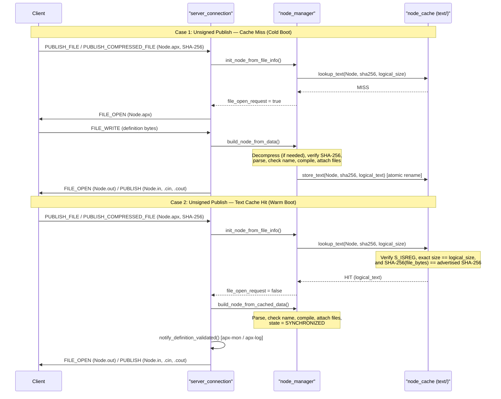

# Server Node Definition Cache Specification

## 1. Overview and Motivation

In automotive and embedded deployments, ECUs frequently sleep and wake, restarting their APX client connections while their node definitions (`.apx` files) remain unchanged between software flashes or OTA updates. On every reconnect without caching:

1. Each client transfers its full `.apx` definition file over IPC or TCP/TLS.
2. The server receives, optionally decompresses, parses, and compiles the definition into port instances and VM bytecode programs.

This specification defines a disk-backed, content-addressable **Node Definition Cache** in `apx-server` (Backlog item 14), modeled after Python's `.py` / `.pyc` two-tier model and designed in **two phases**:

* **Phase 1 (`v0.3.19` — Scope of this implementation)**: Level 1 **text-based cache** keyed by the SHA-256 digest of the logical (uncompressed) APX definition. Eliminates definition file transfer (and decompression for compressed publications) on reconnects while keeping the existing parser/compiler pipeline.
* **Phase 2 (Future)**: Level 2 **binary compiled cache (`.apxc`)** storing precompiled port descriptors, VM bytecode programs, port signatures, and initial values. Eliminates parsing and bytecode compilation overhead as well, including for cryptographically signed nodes after signature verification.

The binary `.apxc` format is intentionally **not** defined in this document. Phase 1 establishes the configuration schema, directory layout, security invariants, `apx_node_cache_t` interface, and server connection/node manager integration so Phase 2 can plug in cleanly without breaking existing configurations or cache directories.

---

## 2. Current Codebase Readiness

The existing `c-apx` codebase already provides most of the protocol and structural foundations needed for Phase 1:

* **Client SHA-256 publication**: `create_definition_file_info()` in `apx_core/src/node_instance.c` already computes `apx_crypto_sha256()` over the logical uncompressed definition text and publishes `RMF_DIGEST_TYPE_SHA256` on both plain (`PUBLISH_FILE`) and compressed (`PUBLISH_COMPRESSED_FILE`) unsigned definitions.
* **Client independence from `.apx` open**: `apx_node_instance_attach_to_file_manager_client_mode()` publishes `.out` and `.apx` independently and does not block waiting for the server to open `.apx`. Skipping `FILE_OPEN` for `.apx` and immediately opening `.out` / publishing `.in`, `.cin`, `.cout` is natively supported by the RemoteFile protocol and existing clients.
* **Server hook points**:
  * `apx_core/include/apx/node_cache.h` and `apx_core/src/node_cache.c` already exist as stub files.
  * `init_node_instance_from_file_info()` in `apx_core/src/node_manager.c` already outputs `bool *file_open_request` with a placeholder comment for node cache lookup.
  * `create_new_node_instance()` in `apx_core/src/server_connection.c` already branches on `if (file_open_request)` with `APX_NOT_IMPLEMENTED_ERROR` in the `else` branch.
* **Crypto & compression alignment**: `apx_crypto_sha256()` (`apx_core/include/apx/crypto.h`) is always available, and `design/compressed_definition_transfer_spec.md` (§6) already defines the normative interaction between compression, signatures, and SHA-256 caching.

---

## 3. Server Configuration Schema

### 3.1. Replacing the Placeholder Keys

Previously, `server.json` examples and `server_cfg.c` contained two unimplemented placeholder keys under `"apx-server"`:

```json
{
    "apx-server": {
        "apx-cache-enabled": false,
        "apx-cache-path": ""
    }
}
```

A single boolean (`apx-cache-enabled`) cannot express the caching tier (off vs. Level 1 text vs. Level 2 binary), nor does a flat pair scale cleanly if future options (e.g., `max-size-mb`, `read-only`) are added.

Following the nested-object convention already used by `"apx-server.security"`, this specification replaces those placeholder keys with a `"cache"` object under `"apx-server"`:

```json
{
    "apx-server": {
        "cache": {
            "level": 0,
            "path": "/var/cache/apx",
            "max-versions-per-node": 10,
            "max-size-mb": 64
        }
    }
}
```

### 3.2. Configuration Parameters

| Key (`apx-server.cache.*`) | Type | Default | Description |
| :--- | :--- | :--- | :--- |
| `level` | Integer (`0`–`2`) | `0` | Cache level: `0` (off), `1` (Level 1 text cache), or `2` (Level 2 binary + Level 1 text cache). |
| `path` | String | `""` | Filesystem directory for cache storage (e.g., `"/var/cache/apx"`). Subdirectories (`text/`, and later `bin/`) are created automatically under this path. |
| `max-versions-per-node` | Integer (`>= 0`) | `10` | Maximum number of cached versions retained per node name (`0` = unlimited). Also accepts alias `max_versions_per_node`. |
| `max-size-mb` | Integer (`>= 0`) | `64` | Maximum total cache size on disk in MiB (`0` = unlimited). Also accepts alias `max_size_mb`. |

### 3.3. Cache Level Semantics

| `level` Value | Enum Constant | Phase 1 (`v0.3.19`) Behavior | Phase 2 (Future) Behavior |
| :--- | :--- | :--- | :--- |
| `0` *(Default)* | `APX_CACHE_LEVEL_OFF` (`0`) | Caching disabled. All definitions are transferred over the wire and compiled. | Same. |
| `1` | `APX_CACHE_LEVEL_TEXT` (`1`) | Level 1 text cache active (`<path>/text/`). Unsigned SHA-256 hits skip transfer (and decompression); definitions are parsed and compiled locally. | Same (text-only caching without `.apxc` generation). |
| `2` | `APX_CACHE_LEVEL_BINARY` (`2`) | Emits a startup warning (`'apx-server.cache.level' value 2 is not yet implemented; using level 1`) and operates at level `1`. | Level 2 binary cache (`<path>/bin/`) checked first, falling back to Level 1 text cache (`<path>/text/`), then wire transfer. |

### 3.4. Validation & Fail-Safe Startup Rules

Caching is a performance optimization and must **never** prevent `apx-server` from starting:

1. **Invalid `cache.level`**: If `level` is not an integer in `[0, 2]` (e.g., negative, `> 2`, boolean, string, float, or non-scalar), emit a startup warning to `stderr` via `apx_server_check_config_unknown_keys_cb()` and default to `0` (`APX_CACHE_LEVEL_OFF`).
2. **Invalid `cache.max-versions-per-node` or `cache.max-size-mb`**: If either value is negative, non-integer, or non-scalar, emit a startup warning and fall back to its default (`10` or `64`).
3. **Missing or empty `cache.path` when `level > 0`**: Emit a startup warning (`'apx-server.cache.path' must be set when cache level is <level>; disabling cache`) and fall back to `APX_CACHE_LEVEL_OFF`. Do **not** silently default to `/tmp` (avoids insecure shared-directory behavior on multi-user systems).
4. **Startup Directory & Permission Probing**:
   * **Uncreatable or unreadable `cache.path` / `<path>/text`** (e.g., `/var/cache` owned by `root` and `<path>` does not exist, or `<path>/text` is `0700` owned by `root`): Emit a clear startup warning including `strerror(errno)` and an ownership/permissions hint, then disable caching (`APX_CACHE_LEVEL_OFF`). Server startup continues normally.
   * **Readable but unwritable `<path>/text`** (e.g., created by `root` with `0755`, or mounted on a read-only OTA partition): Verified at startup via a real create-and-unlink probe file (`.apx_cache_probe.<pid>`) so POSIX ACLs, SELinux/AppArmor, and `EROFS` mounts are caught accurately. Emit a prominent startup warning (`Cache directory '<path>/text' is not writable (<reason>); running cache in read-only mode -- new definitions will not be cached`) and set `read_only = true`. In read-only mode, `lookup_text()` continues serving pre-existing valid entries while skipping `.lock`, `mtime` refresh, `store_text()`, `invalidate_text()`, and eviction (avoiding per-connection write-error spam).
   * **Exclusive Cache Directory Lock (`<path>/.lock`)**: For writable cache directories, `apx-server` acquires a non-blocking exclusive OS lock (`flock(LOCK_EX | LOCK_NB)` on POSIX, `LockFileEx(LOCKFILE_EXCLUSIVE_LOCK | LOCKFILE_FAIL_IMMEDIATELY)` on Windows) on `<path>/.lock` and writes its PID into the file for diagnostics. Because kernel locks are released automatically on process exit or crash (`SIGKILL`/power loss), there are no stale lock files. If another `apx-server` already holds `<path>/.lock` (e.g., copy-pasted config across two server instances), the second server emits a prominent warning including the holder's PID and disables caching (`APX_CACHE_LEVEL_OFF`) while continuing startup cleanly.
   * *(Systemd deployment note)*: Document `CacheDirectory=apx` in `docs/apps/apx_server.rst` so systemd automatically creates `/var/cache/apx` owned by the `apx` service user.
5. **`level == 0` with empty or non-empty `cache.path`**: Valid and silent; no directories are created or touched.

### 3.5. Removal of Legacy Placeholder Keys

Because `"apx-cache-enabled"` and `"apx-cache-path"` were explicitly documented as unimplemented placeholders:

* Remove `"apx-cache-enabled"` and `"apx-cache-path"` cleanly from `m_apx_server_keys[]` in `app/apx_server/src/server_cfg.c`.
* Update all repository example configs (`example/*/server.json`), tests (`app/apx_server/test/testsuite_server_cfg.c`), and documentation (`docs/apps/apx_server.rst`) to use `"cache": { "level": 0, "path": "" }`.
* If an older config file still contains `"apx-cache-enabled"` or `"apx-cache-path"`, the existing unknown-key checker (`apx_server_check_config_unknown_keys_cb()`) will automatically warn on `stderr` and continue startup.

---

## 4. On-Disk Storage Layout & File Safety

### 4.1. Directory Structure

```text
<cache_path>/
├── text/                                      # Phase 1: Level 1 logical .apx text cache
│   ├── NodeA_<64-char-lowercase-sha256>.apx
│   └── NodeB_<64-char-lowercase-sha256>.apx
└── bin/                                       # Phase 2 (reserved): Level 2 compiled .apxc cache
```

### 4.2. Cache Key & Filename Convention

* **Hash input**: Exact logical uncompressed `.apx` definition bytes (length `logical_size`, with **no** extra trailing NUL byte included in the hash).
  * This matches both `create_definition_file_info()` on the client and `apx_node_manager_build_node_from_data()` on the server.
  * Consequently, an entry cached from a plain `PUBLISH_FILE` transfer is a valid cache hit for a subsequent compressed `PUBLISH_COMPRESSED_FILE` publication of the same logical definition, and vice versa.
* **Filename format**: `<node_name>_<sha256_hex>.apx`
  * `<sha256_hex>` is 64 lowercase hexadecimal ASCII characters (`[0-9a-f]{64}`).
  * Including `<node_name>` keeps the cache directory human-readable for operators and OTA tooling without weakening uniqueness (every valid `.apx` text also embeds `N"<node_name>"` inside the hashed content).

### 4.3. Path & Input Sanitization

A client controls the published filename (`rmf_file_info_name`). Before constructing any filesystem path inside `apx_node_cache`:

1. Validate `node_name` is non-empty and within `RMF_MAX_FILE_NAME_SIZE`.
2. Reject any `node_name` containing path separators (`/`, `\`), parent-directory references (`..`), NUL bytes, whitespace, or leading `.` (only permit safe single-component filename characters `[A-Za-z0-9_-]` or `[A-Za-z0-9_.-]` without `..` or leading `.`).
3. If `node_name` fails sanitization, bypass the cache cleanly (treat as cache miss; normal protocol validation will reject invalid node names).
4. On POSIX reads, open cache files with `O_RDONLY | O_NOFOLLOW` (where available) and verify via `fstat()` that the target is a regular file (`S_ISREG`) whose size equals the advertised `logical_size`. Never follow symlinks inside the cache directory.

### 4.4. Atomic Cache Writes & Flash-Wear Avoidance

To prevent torn or half-written cache files on sudden ECU power loss and avoid concurrent write races:

1. **Skip redundant writes**: Before writing, check if `<final_path>` already exists as a regular file with matching size (and optionally skip overwrite). This avoids unnecessary eMMC/NAND flash wear on repeated reconnects.
2. **Unique temporary file**: Create a temporary file in the **same directory** (`<cache_path>/text/`) so it resides on the same filesystem mount:
   `<node_name>_<sha256_hex>.apx.tmp.<pid>.<seq>`
   where `<seq>` is a monotonically increasing `uint64_t` counter incremented under `node_cache->lock`.
3. **Write and flush**: Write all `logical_size` bytes to the temp file, `fflush()`, `fsync()` (on POSIX), and `fclose()`.
4. **Atomic replace**: Rename the temp file into `<final_path>` (`rename()` on POSIX; `MoveFileExA(..., MOVEFILE_REPLACE_EXISTING)` on Windows).
5. **Best-effort cleanup**: If any write, flush, or rename step fails, remove the temp file (`remove()`), log a `WARNING`, and return without failing the client's node attachment.

### 4.5. Cache Eviction & Bloat Prevention

To prevent unbounded cache growth during rapid development cycles (many old SHA-256 versions of the same node) and from renamed or ephemeral nodes, eviction uses two complementary limits enforced only on the **cache store (miss)** path — never on the hot cache-hit path:

1. **Per-Node Version Rotation (`max-versions-per-node`, default `10`, `0` = unlimited)**:
   * Retains at most `N` most-recently-used cached entries per `<node_name>`, preventing single-version thrashing if multiple clients share a node name while keeping development churn bounded.
   * **Exact node-name matching**: When scanning `<cache_path>/text/`, a filename matches `<node_name>` **only** if its total length equals `strlen(node_name) + 1 + 64 + 4`, starts with `<node_name>_`, ends with `.apx`, and the 64 characters between `_` and `.apx` are all lowercase hex (`[0-9a-f]`). This prevents a node named `Foo` from matching `Foo_Bar_<sha256>.apx`.
2. **Global Cache Size Cap (`max-size-mb`, default `64`, `0` = unlimited)**:
   * Caps total bytes across all `.apx` files in `<cache_path>/text/` (and in Phase 2, across `text/` + `bin/`).
   * Protects embedded storage partitions against orphaned, renamed, or ephemeral test nodes.
3. **Single-Pass Eviction Algorithm (on store)**:
   * After atomically renaming the newly stored `<final_name>` into `<cache_path>/text/`, acquire `node_cache->prune_lock` (or `trylock` / serialize pruning) and perform a single `opendir()` / `readdir()` pass over `<cache_path>/text/`, collecting `(filename, size, mtime, matches_current_node)` for valid cache entries (ignoring active `*.tmp.*` files).
   * **Step 1 (Per-node cap)**: If `max_versions_per_node > 0`, sort entries matching `<node_name>` by ascending `mtime` and `unlink()` the oldest excess entries (never unlinking `<final_name>`) until count `<= max_versions_per_node`, subtracting removed bytes from `total_bytes`.
   * **Step 2 (Global cap)**: If `max_size_mb > 0` and `total_bytes > max_size_bytes`, sort all remaining entries by ascending `mtime` and `unlink()` the oldest entries (never unlinking `<final_name>`) until `total_bytes <= max_size_bytes`.
4. **Throttled LRU Timestamp Refresh (on hit)**:
   * On a successful `lookup_text()`, if `max_versions_per_node > 0` or `max_size_mb > 0`, refresh the file's `mtime` via `utimensat()` **only if** `now - mtime >= 60` seconds.
   * This gives true LRU eviction without any external index file (zero metadata corruption risk) while avoiding flash wear on frequent reconnects.

---

## 5. Cache Resolution, Security, and Fallback Flows

### 5.1. Security & Digest Invariants

Consistent with `design/compressed_definition_transfer_spec.md` (§6) and Backlog item 14:

1. **Signed-node admission policy runs FIRST**: If `apx_server_get_require_signed_nodes(server)` is `true` and the publication is unsigned, reject immediately (`APX_SIGNATURE_MISSING_ERROR`) without consulting the cache.
2. **Signed publications NEVER skip wire transfer (Phase 1 / current RMFP 1.1)**: For `PUBLISH_SIGNED_FILE` and `PUBLISH_SIGNED_COMPRESSED_FILE`, `*file_open_request` is **always** `true`. The server must receive the definition bytes and run `apx_server_verify_node_signature()` against configured trusted keys.
   * In Phase 1 (Level 1 text cache), signed definitions neither read from nor write to `<cache_path>/text/`.
   * Extending RMFP/1.1 signed publication commands (`21` and `23`) to carry `SHA-256` alongside the signature so signed nodes can also verify signatures pre-transfer and hit the cache is tracked separately in Backlog Item 25.
3. **Unsupported `RMF_DIGEST_TYPE_SHA1` rejected**: No APX client implements SHA-1 digests, and `PUBLISH_COMPRESSED_FILE` already rejects `RMF_DIGEST_TYPE_SHA1` with `APX_UNSUPPORTED_ERROR`. Plain `.apx` publications advertising `RMF_DIGEST_TYPE_SHA1` MUST likewise be rejected with `APX_UNSUPPORTED_ERROR` rather than silently accepting an unverified checksum.
4. **Client opt-in via `RMF_DIGEST_TYPE_SHA256`**:
   * Filling in `RMF_DIGEST_TYPE_SHA256` is optional for clients.
   * When a client publishes with `RMF_DIGEST_TYPE_NONE`, the server treats it as a cache miss (`*file_open_request = true`) and **does not** insert the definition into `<cache_path>/text/` (avoiding wasted disk/flash writes and `max-size-mb` churn for clients that will never perform Level 1 lookups).
   * In Phase 2 (Level 2 binary `.apxc`), the server may still compute SHA-256 post-transfer to reuse precompiled `.apxc` entries for `RMF_DIGEST_TYPE_NONE` and signed clients.
5. **Never cache unvalidated definitions**: An unsigned `RMF_DIGEST_TYPE_SHA256` definition received over the wire is written to `<cache_path>/text/` **only after** decompression (if compressed), SHA-256 verification, parsing, declared-name check (`N"..."` matches filename), and port compilation all succeed.

### 5.2. Sequence Flows



### 5.3. Resilient Corruption Fallback

Every failure in the cache path must transparently degrade to a standard wire download without producing spurious client rejections:

1. **Read / integrity mismatch during `lookup_text()`**:
   * If the file is missing: normal miss (`*file_open_request = true`).
   * If the file size does not equal `logical_size`, or `apx_crypto_sha256(bytes, logical_size)` does not equal the advertised digest: log a `WARNING`, best-effort `unlink()` the corrupt cache file, and return miss (`*file_open_request = true`).
2. **Unexpected parse/compile failure during `build_node_from_cached_data()`**:
   * Although the server only stores validated definitions, a file pre-populated offline or modified between checks could fail parsing/compilation.
   * Do **not** reject/NACK directly from the cache path. Instead: best-effort `unlink()` the cache entry, log a `WARNING`, reset `node_data` for wire transfer (`encoded_size`), and fall through to `FILE_OPEN`.
   * If the client's actual definition is genuinely invalid, the standard wire-transfer path will reject it with the exact same `NODE_DEFINITION_REJECTED` event and NACK code as when caching is disabled.

---

## 6. Architecture and Module Design

### 6.0. Cross-Platform Filesystem Helpers (`cutil/include/fileutil.h`, `cutil/src/fileutil.c`)

To keep `apx_core/src/node_cache.c` portable across Linux and Windows without duplicating platform `#ifdef` logic, add generic file/directory primitives to the `cutil` submodule (`feature/fileutil-dir-ops`):

* `int cutil_mkdir_p(const char *path);` — recursively creates directories (`mkdir` on POSIX, `_mkdir` on Windows); returns `0` if created or already a directory, `-1` on error (preserving `errno`).
* `int cutil_dir_for_each(const char *dir_path, cutil_dir_entry_cb cb, void *arg);` — iterates regular/directory entries (skipping `.` and `..`), supplying `cutil_dir_entry_t` (`name`, `size`, `mtime_sec`, `is_reg`, `is_dir`, `is_symlink`) via `opendir`/`readdir`/`lstat` on POSIX and `FindFirstFileA`/`FindNextFileA` on Windows.
* `int cutil_read_regular_file(const char *path, uint8_t *buf, size_t expected_size, int64_t *out_mtime_sec);` — opens without following symlinks (`O_RDONLY | O_NOFOLLOW` + `fstat` `S_ISREG` on POSIX; `FILE_ATTRIBUTE_REPARSE_POINT` check on Windows), verifies exact file size equals `expected_size`, reads all bytes, and optionally returns `mtime_sec`.
* `int cutil_file_replace_atomic(const char *src_path, const char *dst_path);` — `rename()` on POSIX, `MoveFileExA(..., MOVEFILE_REPLACE_EXISTING)` on Windows.
* `int cutil_file_touch_mtime(const char *path);` — updates `mtime` to current time (`utimensat(..., AT_SYMLINK_NOFOLLOW)` on POSIX, `_utime(path, NULL)` on Windows).
* `int cutil_fsync_file(FILE *fh);` — flushes C stream + syncs OS file descriptor (`fsync(fileno(fh))` on POSIX, `_commit(_fileno(fh))` on Windows).

### 6.1. `apx_node_cache_t` (`apx_core/include/apx/node_cache.h`, `apx_core/src/node_cache.c`)

Replace the stub `apx_node_cache_t` with the server cache service:

```c
#define APX_CACHE_DEFAULT_MAX_VERSIONS_PER_NODE 10u
#define APX_CACHE_DEFAULT_MAX_SIZE_MB 64u
#define APX_CACHE_MTIME_REFRESH_INTERVAL_SEC 60

typedef enum apx_cache_level_tag
{
  APX_CACHE_LEVEL_OFF = 0,
  APX_CACHE_LEVEL_TEXT = 1,
  APX_CACHE_LEVEL_BINARY = 2
} apx_cache_level_t;

typedef struct apx_node_cache_config_tag
{
  apx_cache_level_t level;
  uint32_t max_versions_per_node;
  uint32_t max_size_mb;
} apx_node_cache_config_t;

typedef struct apx_node_cache_stats_tag
{
  uint64_t text_hits;
  uint64_t text_misses;
  uint64_t text_stores;
  uint64_t text_evictions;
  uint64_t text_corruptions;
  uint64_t io_errors;
} apx_node_cache_stats_t;

typedef struct apx_node_cache_tag
{
  apx_cache_level_t level;
  uint32_t max_versions_per_node;
  uint32_t max_size_mb;
  adt_str_t root_dir;
  adt_str_t text_dir;
  MUTEX_T lock;
  MUTEX_T prune_lock;
  uint64_t tmp_seq;
  apx_node_cache_stats_t stats;
  bool initialized;
  bool read_only;
} apx_node_cache_t;
```

Core API functions:

* `void apx_node_cache_create(apx_node_cache_t *self);`
* `void apx_node_cache_destroy(apx_node_cache_t *self);`
* `apx_error_t apx_node_cache_configure(apx_node_cache_t *self, apx_node_cache_config_t const *cfg, char const *root_path);`
  * Validates `cfg->level`, limits, and `root_path`.
  * When `cfg->level != APX_CACHE_LEVEL_OFF`, ensures `root_path` and `<root_path>/text` exist (creating them if needed) and verifies directory status.
  * When `cfg->level == APX_CACHE_LEVEL_BINARY` in Phase 1, operates with text caching enabled (caller logs the Phase 1 fallback warning during config check).
* `bool apx_node_cache_is_text_enabled(apx_node_cache_t const *self);`
* `apx_cache_level_t apx_node_cache_get_level(apx_node_cache_t const *self);`
* `uint32_t apx_node_cache_get_max_versions_per_node(apx_node_cache_t const *self);`
* `uint32_t apx_node_cache_get_max_size_mb(apx_node_cache_t const *self);`
* `char const *apx_node_cache_get_root_path(apx_node_cache_t const *self);`
* `apx_error_t apx_node_cache_lookup_text(apx_node_cache_t *self, char const *node_name, uint8_t const sha256[RMF_SHA256_SIZE], uint32_t expected_size, uint8_t **out_data);`
  * On hit: allocates `expected_size + 1` bytes (`out_data[expected_size] = '\0'`), verifies exact size and SHA-256, performs throttled `mtime` refresh (if eviction is enabled and `mtime` is older than 60 s), increments `text_hits`, returns `APX_NO_ERROR`. Caller owns `*out_data` (`free()`).
  * On miss: increments `text_misses`, returns `APX_FILE_NOT_FOUND_ERROR`.
  * On corruption: unlinks bad file, increments `text_corruptions`, returns `APX_CHECKSUM_ERROR` (or `APX_LENGTH_ERROR`).
* `apx_error_t apx_node_cache_store_text(apx_node_cache_t *self, char const *node_name, uint8_t const sha256[RMF_SHA256_SIZE], uint8_t const *data, uint32_t size);`
  * Performs atomic temp-write + `rename()`, increments `text_stores` (or `io_errors` on failure), and runs single-pass per-node + global-size eviction under `prune_lock` when limits are non-zero.
* `void apx_node_cache_invalidate_text(apx_node_cache_t *self, char const *node_name, uint8_t const sha256[RMF_SHA256_SIZE]);`
  * Best-effort unlink of `<text_dir>/<node_name>_<sha256>.apx`.
* `void apx_node_cache_get_stats(apx_node_cache_t *self, apx_node_cache_stats_t *out_stats);`
  * Copies statistics snapshot under `self->lock` (useful for unit tests and future `apx-mon` diagnostics).

### 6.2. `apx_server_t` Integration (`apx_core/include/apx/server.h`, `apx_core/src/server.c`)

* Embed `apx_node_cache_t node_cache;` directly in `apx_server_t`.
* Initialize in `apx_server_create()` (defaults to `APX_CACHE_LEVEL_OFF`) and clean up in `apx_server_destroy()`.
* Expose accessors:
  * `apx_error_t apx_server_configure_cache(apx_server_t *self, apx_node_cache_config_t const *cfg, char const *cache_path);`
  * `apx_node_cache_t *apx_server_get_node_cache(apx_server_t *self);`

### 6.3. `apx_node_manager_t` Integration (`apx_core/src/node_manager.c`)

1. **`init_node_instance_from_file_info()`**:
   * Reject `rmf_file_info_digest_type(file_info) == RMF_DIGEST_TYPE_SHA1` immediately with `APX_UNSUPPORTED_ERROR` (consistent with `PUBLISH_COMPRESSED_FILE`).
   * Keep all existing size validation (`encoded_size`, `logical_size`), `base_name` validation, and memory reservation checks.
   * Before deciding `*file_open_request`, check if:
     * `server != NULL`
     * `apx_node_cache_is_text_enabled(apx_server_get_node_cache(server))`
     * `!rmf_file_info_is_signed(file_info)`
     * `rmf_file_info_digest_type(file_info) == RMF_DIGEST_TYPE_SHA256`
   * If eligible, call `apx_node_cache_lookup_text(cache, base_name, digest_data, logical_size, &cached_text)`.
   * **On cache hit**:
     * Initialize `node_data` with `(cached_text, logical_size)` via `apx_node_instance_init_node_data(node_instance, cached_text, (apx_size_t)logical_size)` and `free(cached_text)`.
     * Set `*file_open_request = false`.
   * **On miss / corruption / ineligible**:
     * Log warning on corruption (if `APX_CHECKSUM_ERROR` or `APX_LENGTH_ERROR`).
     * Initialize `node_data` with `(NULL, encoded_size)` as today.
     * Set `*file_open_request = true`.

2. **Shared parse/compile/attach helper**:
   * Factor out the common post-validation pipeline from `apx_node_manager_build_node_from_data()` into an internal helper:
     `parse_and_compile_definition(self, node_instance, definition_data, definition_size, &stage)`
     covering: `apx_parser_parse_bstr`, declared node-name match check, `build_node_instance`, and `apx_node_instance_attach_to_file_manager`.
   * **`apx_node_manager_build_node_from_cached_data(self, node_instance)`**:
     * Takes logical definition snapshot from `node_data` (already verified logical text of size `logical_size`).
     * Runs `parse_and_compile_definition()` — intentionally **skipping** decompression, digest re-hashing, and signature verification.
     * On success: releases `definition_memory_reservation`, transitions `definition_data_state` to `APX_DATA_STATE_SYNCHRONIZED`, and logs at `INFO` level:
       `[%u] Server created node %s (cache hit: text)`
     * On failure: does **not** call `apx_node_manager_reject_definition()` — returns the error so `server_connection.c` can invalidate the cache entry, re-initialize `node_data` to `(NULL, encoded_size)`, and fall back cleanly to wire download.
   * **`apx_node_manager_build_node_from_data(self, node_instance)`** (existing wire path):
     * Keeps decompression, digest check, signature check, parse, name check, compile, and attach unchanged.
     * After `parse_and_compile_definition()` succeeds, if `server != NULL`, `apx_node_cache_is_text_enabled(cache)`, `def_file != NULL && !apx_file_is_signed(def_file)`, **and** `apx_file_get_digest_type(def_file) == RMF_DIGEST_TYPE_SHA256`:
       * Reuse the already-verified `hash` directly (no duplicate SHA-256 computation).
       * Call `apx_node_cache_store_text(cache, expected_name, hash, definition_data, (uint32_t)definition_size)`.
       * If store fails, log a `WARNING` and continue (do not fail node creation).

### 6.4. `apx_server_connection_t` Integration (`apx_core/src/server_connection.c`)

1. Extract `notify_definition_validated(apx_server_connection_t *self, apx_node_instance_t *node)` from lines 820–829 of `remote_file_write_notification()`.
2. Update `create_new_node_instance()` (currently `APX_NOT_IMPLEMENTED_ERROR` at line 720):
   * Link `definition_file` via `apx_node_instance_remote_file_published_notification(node_instance, definition_file)`.
   * Handle `if (!file_open_request)` **before** `if (file_open_request)`:
     * Call `apx_node_manager_build_node_from_cached_data(node_manager, node_instance)`.
     * **If `APX_NO_ERROR`**:
       * Detach write notification handler on `definition_file` (`apx_file_set_notification_handler(definition_file, NULL)`), keeping `node_instance->definition_file` intact for metadata/snapshots.
       * Call `notify_definition_validated(self, node_instance)`.
       * Return `APX_NO_ERROR` (never sending `FILE_OPEN` for `.apx`).
     * **If error (unexpected cached parse/compile failure)**:
       * Call `apx_node_cache_invalidate_text(...)` and log a `WARNING` that the server is falling back to wire transfer.
       * Reset `node_data` definition buffer to `(NULL, encoded_size)` via `apx_node_data_replace_definition_data` / re-init helper.
       * Set `file_open_request = true` and fall straight into the standard `if (file_open_request)` block.

---

## 7. Concurrency and Thread Safety

`apx-server` processes concurrent client connections on independent worker threads (`msocket` / file manager threads) sharing a single `apx_server_t` and `apx_node_cache_t`:

1. **Zero Disk I/O Under `server->global_lock`**:
   * Cache lookup in `init_node_instance_from_file_info()` and cache store in `apx_node_manager_build_node_from_data()` both run outside `server->global_lock`.
2. **Minimal Lock Scope in `apx_node_cache_t`**:
   * `node_cache->lock` protects only the `tmp_seq` counter and `stats` fields (`text_hits`, `text_misses`, `text_stores`, `text_evictions`, `text_corruptions`, `io_errors`).
   * `node_cache->prune_lock` serializes eviction scans on store so concurrent misses do not run duplicate `readdir()` passes; reads never acquire `prune_lock` (and POSIX `unlink()` of an already-opened file is safe for concurrent readers).
   * `level`, `max_versions_per_node`, `max_size_mb`, `root_dir`, and `text_dir` are configured once before `apx_server_start()` and are read-only while connections are active.
   * Normal file reads and writes (`open`, `read`, `write`, `fsync`, `rename`) run without holding `node_cache->lock` or `prune_lock`.
3. **Concurrent Connections Publishing Identical `.apx` Files**:
   * Because every writer uses a unique temporary filename (`*.tmp.<pid>.<seq>`) and commits via atomic `rename()`, two clients simultaneously connecting on a cold cache with the exact same `.apx` will both succeed cleanly without file corruption, data races, or mutex contention.
4. **Deadlock Prevention Rule**:
   * `notify_definition_validated()` snapshots listeners under `event_listener_lock` and invokes callbacks after releasing the lock, preserving the repository's lock-free callback invariant.

---

## 8. Observability and Diagnostics Integration

* **Text Logging (`apx_text_log_extension`)**:
  * Cache hit: `[<conn_id>] Server created node <name> (cache hit: text)` (`INFO`)
  * Cache corruption / fallback: `[<conn_id>] Invalid text cache entry for node '<name>' (<reason>); falling back to transfer` (`WARNING`)
  * Cache write failure: `[<conn_id>] Failed to write text cache for node '<name>': <reason>` (`WARNING`)
  * Startup config warnings: emitted to `stderr` via `apx_server_check_config_unknown_keys_cb()` identically to `multiple-provider-policy` and `max-concurrent-connections`.
* **Monitor & `.apxlog` (`apx_monitor_extension`, `apx-mon`, `apx-log`)**:
  * On a cache hit, `node_data` contains the exact logical uncompressed definition text (`logical_size`), and `notify_definition_validated()` runs immediately upon synchronization.
  * `on_definition_validated()` in `server_monitor.c` therefore emits the same normalized logical `FILE_PUBLISH` + `FILE_OPEN` + `FILE_WRITE` events to live streamers, and snapshot queries inspect `node_data` identically to wire-transferred nodes.
  * No changes to `.apxlog` format or monitor wire protocols are required.

---

## 9. Explicit Non-Goals for Phase 1 (`v0.3.19`)

The following items are intentionally deferred beyond Phase 1:

* **Level 2 binary cache format (`.apxc`)**: Binary header, bytecode serialization, init-data serialization, and post-signature-verification binary lookup for signed nodes (Phase 2).
* **Signed-node pre-open caching**: Adding `SHA-256` to RMFP/1.1 signed publication commands (`21` and `23`) so signed nodes can also skip wire transfer on cache hits (tracked in Backlog Item 25).
* **Offline pre-warming & manual pruning CLI**: Dedicated `apx-cache` CLI commands (note: Phase 1's `<cache_path>/text/<node_name>_<sha256>.apx` format is simple enough that standard shell/OTA scripts can already inspect or pre-populate it directly).
* **Client-side caching**: Only server-side caching is in scope.

---

## 10. Testing and Acceptance Criteria

All changes must pass the repository's mandatory verification matrix (`clang-format`, `clang-test`, `clang-asan`, `clang-tsan`, `clang-tidy`, and `pytest -v -n auto`).

### 10.1. C Unit Tests

* **`testsuite_node_cache.c` (new)**:
  * Default state (`APX_CACHE_LEVEL_OFF`), directory creation under `configure()`, invalid/empty path handling.
  * Store + lookup round-trip returning exact bytes and NUL termination.
  * Miss when file absent or digest differs.
  * Corruption detection and auto-eviction: wrong file size, flipped byte (SHA-256 mismatch), symlink rejection.
  * Path traversal rejection (`../evil`, `a/b`, `.hidden`).
  * Duplicate store idempotency (existing entry preserved without error) and stats counter verification.
  * Per-node rotation (`max-versions-per-node`): storing `N+2` versions keeps the `N` newest and evicts the oldest; verifies `Foo` never matches/evicts `Foo_Bar`.
  * Global size cap (`max-size-mb`): evicts globally oldest entries across multiple nodes until total size is within budget, never evicting the newly stored entry.
  * LRU refresh on hit: accessing an older entry (with backdated `mtime`) refreshes its `mtime` so it survives subsequent rotation.
* **`testsuite_server_cfg.c`**:
  * Valid `"cache": { "level": 0 | 1 | 2, "path": "...", "max-versions-per-node": 10, "max-size-mb": 64 }` (and underscore aliases).
  * Startup warning when `level` is `2` (fallback to level `1`).
  * Startup warning and fail-safe disable when `level` is invalid (out of range or non-integer) or `path` is empty with `level > 0`, and default fallback warnings for invalid `max-versions-per-node` / `max-size-mb`.
  * Unknown-key warnings for typos under `"apx-server.cache.*"` and for removed legacy `"apx-cache-enabled"` / `"apx-cache-path"` keys.
* **`testsuite_node_manager_server.c` & `testsuite_server_connection.c`**:
  * Unsigned `.apx` with SHA-256: cold miss sets `file_open_request = true` and populates cache; second connection sets `file_open_request = false`, does **not** emit `FILE_OPEN` for `.apx`, builds node, and fires `definition_validated`.
  * Unsigned compressed `.apx` (`PUBLISH_COMPRESSED_FILE`) hits a text entry cached from an uncompressed publish (and vice versa).
  * Unsigned `.apx` with `RMF_DIGEST_TYPE_NONE` always opens, transfers, and does **not** write to `<cache_path>/text/`.
  * Plain `.apx` with legacy `RMF_DIGEST_TYPE_SHA1` is rejected with `APX_UNSUPPORTED_ERROR`.
  * Signed `.apx` (both plain and compressed) always sets `file_open_request = true` even when text cache is enabled and a matching file exists on disk.
  * Corrupted cache file (both byte-corrupt and unparseable) transparently falls back to wire download without rejecting a valid client.

### 10.2. Multi-Process Integration Tests (`tests/test_server_node_cache.py`)

* **Warm reconnect skips `.apx` transfer**: Start `apx-server` with `cache.level = 1` and a `tmp_path` cache directory; connect `apx-node` (cold miss creates `<tmp_path>/text/<node>_<sha256>.apx`); reconnect `apx-node` and verify signal routing works end-to-end and server logs show a cache hit without `Server open file: <node>.apx`.
* **Cross-representation hit**: Populate cache with uncompressed `apx-node`, then connect `apx-node --compressed` with the same `.apx` file and verify a cache hit (and vice versa).
* **Definition update invalidation**: Modify `.apx`, reconnect, verify miss + new `<node>_<new_sha256>.apx` file created and updated ports route properly.
* **Corruption recovery**: Tamper with cached `.apx` on disk (both truncated and same-length modified bytes), reconnect `apx-node`, verify server recovers via wire download, heals cache file, and routes signals normally.
* **Signed-node security**: With `require-signed-nodes: true` and `cache.level = 1`, verify unsigned nodes are rejected even if a matching file exists in `<cache_path>/text/`, and signed nodes still transfer and verify normally.
* **Monitor & `.apxlog` parity**: Connect `apx-mon` / event streamer during a cache-hit connection and verify the logical definition is still recorded/visible in both live stream and snapshots.
* **Concurrency**: Launch multiple `apx-node` processes concurrently against both a cold cache and a warm cache under `clang-asan` and `clang-tsan`.

