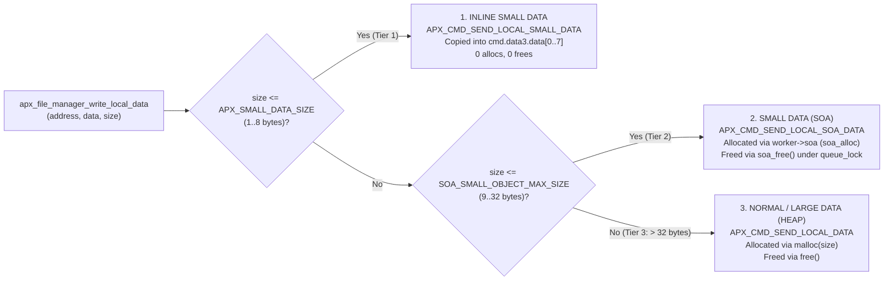

# Design Proposal: 3-Tier Data Command Pipeline & Retiring `apx_allocator_t`

* **Status**: Proposed
* **Target Release**: `c-apx` v0.4.0 (Roadmap Item 12)
* **Affected Components**: `apx_core` (`cfg.h`, `command.h`, `command.c`, `file_manager.h`, `file_manager.c`, `file_manager_shared.h`, `file_manager_shared.c`, `file_manager_worker.h`, `file_manager_worker.c`, `node_instance.c`, `connection_base.h`, `connection_base.c`; retire `allocator.h`, `allocator.c`, `testsuite_allocator.c`)

---

## 1. Historical Analysis (`v0.2.8` & `v0.3.0` vs. Current `v0.3.x`)

An archaeology of `c-apx` `v0.2.8` (`/home/cogu/maintain/c-apx`) and the `v0.3.x` git history reveals how small data and `soa_t` evolved:

### 1.1 Inline Small Data (`APX_SMALL_DATA_SIZE`)

In both `v0.2.8` (`apx/common/inc/apx_msg.h:22-27`) and `v0.3.x` ([`apx_core/include/apx/command.h:48-52`](../apx_core/include/apx/command.h#L48-L52)), each command queued in the worker ringbuffer contains two `uint32_t` fields (`data1`, `data2`), a `union` (`data3`), and a `void *` (`data4`):

```c
typedef struct apx_command_tag
{
  apx_cmd_type_t cmd_type;
  uint32_t data1;
  uint32_t data2;
  union
  {
    void *ptr;
    uint8_t data[APX_SMALL_DATA_SIZE];
  } data3;
  void *data4;
} apx_command_t;
```

* In `v0.2.8`, `apx_es_cfg.h` (targeting 32-bit MCUs) defined `#define APX_SMALL_DATA_SIZE 4` and used `RMF_MSG_DIRECT_WRITE`, while desktop builds defined `#define APX_SMALL_DATA_SIZE 8`.
* In `v0.3.x` ([`apx_core/include/apx/cfg.h:64`](../apx_core/include/apx/cfg.h#L64)), `APX_SMALL_DATA_SIZE` is `8u`.
* **Note on 32-bit vs. 64-bit in `v0.3.x`**: In `v0.3.x`, RemoteFile v1.1 stream commands (`APX_CMD_SEND_STREAM_OPEN_RSP` and `APX_CMD_SEND_STREAM_WINDOW_UPDATE` in [`file_manager_worker.c:425-447`](../apx_core/src/file_manager_worker.c#L425-L447)) pack 8 bytes into `cmd.data3.data[0..7]`. Therefore, `APX_SMALL_DATA_SIZE` in `v0.3.x` must remain `8u` so `cmd.data3.data` is always at least 8 bytes.
* **Note on struct padding for future flags**: Because `cmd_type` is `uint8_t` (offset `0`) and `data1` is `uint32_t` (offset `4`), the compiler inserts 3 alignment padding bytes at offsets `1..3`. If future commands ever need bit-flags, a `uint8_t cmd_flags` (or `uint16_t cmd_flags`) field can be placed immediately after `cmd_type` with zero increase to `sizeof(apx_command_t)`.

### 1.2 Small Object Allocator (`soa_t` / `apx_allocator_t`)

* In `v0.2.8` (`apx_allocator.h` / `apx_allocator.c`), `apx_allocator_t` wrapped `cutil`'s `soa_t` (`SOA_SMALL_OBJECT_MAX_SIZE = 32` bytes) together with a spinlock, a ringbuffer, a semaphore, and a dedicated background garbage-collector `pthread`.
* During the `v0.3.x` IDL v1.3 refactoring (`commit f9e76d0`), [`remote_route_data_to_file()`](../apx_core/src/node_instance.c#L2195) was rewritten to call `malloc(size)` and [`run_send_local_data()`](../apx_core/src/file_manager_worker.c#L756) was changed to call `free(data)`, leaving `apx_connection_base_t->allocator` running an idle background `pthread` per connection that nothing in the codebase ever called.
* Because `soa_alloc()` and `soa_free()` are fast $O(1)$ freelist pointer operations (`cutil/src/soa.c`), spawning a dedicated garbage-collector thread per connection and posting a semaphore for every deallocation adds unnecessary thread and synchronization overhead.

### 1.3 Why `command.h` Lacked the Field Usage Comment Block

The large comment block documenting field usage (`data1`, `data2`, `data3`, `data4`) and ownership was written in **[`apx_core/include/apx/event.h:54-75`](../apx_core/include/apx/event.h#L54-L75)** for `apx_event_t`, while the older `v0.3.0` `apx_msg.h` had inline comments per message type that were omitted when `command.h` was created. Adding a matching `"Command field usage and ownership"` comment block to `command.h` will bring `command.h` up to the same standard as `event.h`.

---

## 2. Architecture: 3-Tier Data Allocation in `apx_file_manager_t`

Instead of maintaining a separate `apx_allocator_t` wrapper and background thread on every connection, we **retire `allocator.c` / `allocator.h`** and embed `soa_t` directly inside `apx_file_manager_worker_t` (protected by its existing `SPINLOCK_T queue_lock`).

All local file data writes that copy caller data (`apx_file_manager_write_local_data()` / `apx_file_manager_send_local_data_copy()`) are classified by `file_manager` into **3 tiers** based on payload `size`:



### 2.1 The Three Allocation Tiers

| Tier | Payload Size | Command Type (`apx_cmd_type_t`) | Storage Location | Deallocation in Worker / Queue Cleanup |
| :--- | :--- | :--- | :--- | :--- |
| **1. Inline Small Data** | `1 .. 8` bytes (`<= APX_SMALL_DATA_SIZE`) | `APX_CMD_SEND_LOCAL_SMALL_DATA` | Inline in `cmd.data3.data[0..7]` inside the command ringbuffer | None (zero allocation) |
| **2. Small Data (SOA)** | `9 .. 32` bytes (`<= SOA_SMALL_OBJECT_MAX_SIZE`) | `APX_CMD_SEND_LOCAL_SOA_DATA` | `cmd.data3.ptr` allocated from `worker->soa` via `soa_alloc()` | `soa_free(&self->soa, cmd.data3.ptr, cmd.data2)` under `self->queue_lock` |
| **3. Normal / Large Data** | `> 32` bytes (`> SOA_SMALL_OBJECT_MAX_SIZE`) | `APX_CMD_SEND_LOCAL_DATA` | `cmd.data3.ptr` allocated on heap via `malloc()` | `free(cmd.data3.ptr)` |

*(Note: `APX_CMD_SEND_LOCAL_CONST_DATA` remains unchanged for static/persistent read-only buffers such as `.apx` definition text where `cmd.data3.ptr` is not freed. In addition, existing callers of `apx_file_manager_send_local_data()` that pass a pre-allocated `malloc()` buffer continue to use `APX_CMD_SEND_LOCAL_DATA` and `free()` safely regardless of buffer size.)*

### 2.2 Zero-Extra-Lock SOA Management in `apx_file_manager_worker_t`

In [`apx_core/include/apx/file_manager_worker.h`](../apx_core/include/apx/file_manager_worker.h), `apx_file_manager_worker_t` already has `SPINLOCK_T queue_lock` which is acquired whenever a command is inserted into or removed from `self->queue`.

By placing `soa_t soa;` inside `apx_file_manager_worker_t` and protecting it with `self->queue_lock`:
* **On Enqueue (Tier 2: `9..32` bytes)**:
  ```c
  SPINLOCK_ENTER(self->queue_lock);
  uint8_t *soa_buf = (uint8_t *)soa_alloc(&self->soa, size);
  if (soa_buf != NULL)
  {
    memcpy(soa_buf, data, size);
    apx_build_command_with_ptr(&cmd, APX_CMD_SEND_LOCAL_SOA_DATA, address, size, soa_buf, NULL);
    rc = adt_rbfh_insert(&self->queue, (const uint8_t *)&cmd);
    if (rc != BUF_E_OK)
    {
      soa_free(&self->soa, soa_buf, size);
    }
  }
  SPINLOCK_LEAVE(self->queue_lock);
  ```
  Both `soa_alloc()` and `adt_rbfh_insert()` happen inside the **single** `self->queue_lock` critical section!
* **On Transmit (`process_single_command` in `file_manager_worker.c`)**:
  ```c
  case APX_CMD_SEND_LOCAL_SMALL_DATA:
    result = run_send_local_const_data(self, cmd->data1, &cmd->data3.data[0], cmd->data2);
    break;
  case APX_CMD_SEND_LOCAL_SOA_DATA:
    result = run_send_local_soa_data(self, cmd->data1, (uint8_t *)cmd->data3.ptr, cmd->data2);
    break;
  case APX_CMD_SEND_LOCAL_DATA:
    result = run_send_local_data(self, cmd->data1, (uint8_t *)cmd->data3.ptr, cmd->data2);
    break;
  ```
  Where `run_send_local_soa_data()` transmits the data via `run_send_local_const_data()` and then returns the block to `self->soa`:
  ```c
  SPINLOCK_ENTER(self->queue_lock);
  soa_free(&self->soa, data, size);
  SPINLOCK_LEAVE(self->queue_lock);
  ```
* **On Queue Cleanup (`cleanup_cmd_queue` in `file_manager_worker.c`)**:
  When draining any unsent commands on shutdown/disconnect (`cleanup_cmd_queue(apx_file_manager_worker_t *self)`):
  * `APX_CMD_PUBLISH_LOCAL_FILE`: `rmf_file_info_delete((rmf_file_info_t *)cmd.data3.ptr)`
  * `APX_CMD_SEND_LOCAL_SOA_DATA`: `soa_free(&self->soa, cmd.data3.ptr, cmd.data2)`
  * `APX_CMD_SEND_LOCAL_DATA`, `APX_CMD_CREATE_CONNECTION`, `APX_CMD_SEND_ERROR_CODE`: `free(cmd.data3.ptr)`

### 2.3 Fixing `apx_build_command_with_data()` Out-of-Bounds Read (`apx_core/src/command.c`)

Currently, [`apx_build_command_with_data()`](../apx_core/src/command.c#L42-L53) unconditionally copies `APX_SMALL_DATA_SIZE` (`8`) bytes from `d3`:

```c
memcpy(&self->data3.data[0], d3, APX_SMALL_DATA_SIZE); // BUG: reads past d3 when d2 < APX_SMALL_DATA_SIZE!
```

When `d3` points to a 1-, 2-, or 4-byte variable (such as `uint8_t count_bytes[2]` in `apx_node_instance_send_provide_port_count_data()`), copying 8 bytes reads past the stack buffer and triggers an AddressSanitizer (`clang-asan`) stack-buffer-overflow error.

**Fix**:
Validate `d2 <= APX_SMALL_DATA_SIZE` and copy `(size_t)d2` bytes:

```c
void apx_build_command_with_data(
  apx_command_t *self, apx_cmd_type_t cmd_type, uint32_t d1, uint32_t d2, uint8_t const *d3, void *d4)
{
  if ((self != NULL) && (d2 <= APX_SMALL_DATA_SIZE))
  {
    self->cmd_type = cmd_type;
    self->data1 = d1;
    self->data2 = d2;
    if ((d3 != NULL) && (d2 > 0u))
    {
      memcpy(&self->data3.data[0], d3, (size_t)d2);
    }
    self->data4 = d4;
  }
}
```

### 2.4 Documenting `apx_command_t` in `apx_core/include/apx/command.h`

Add a comprehensive comment block to [`apx_core/include/apx/command.h`](../apx_core/include/apx/command.h) (matching [`apx_core/include/apx/event.h:54-75`](../apx_core/include/apx/event.h#L54-L75)) documenting the exact field usage and memory ownership for every `APX_CMD_*`:

```c
/**
 * Command field usage and ownership:
 *
 * APX_CMD_EXIT:
 *   - Signals the worker thread to exit. No data fields used.
 *
 * APX_CMD_SEND_ACKNOWLEDGE:
 *   - Sends RMF_CMD_ACK_MSG. No data fields used.
 *
 * APX_CMD_SEND_ERROR_CODE:
 *   - data1: Error code (apx_error_t)
 *   - data3.ptr: Optional file/context name (char *, strong reference: allocated via STRDUP, freed with free)
 *
 * APX_CMD_PUBLISH_LOCAL_FILE:
 *   - data3.ptr: File info object (rmf_file_info_t *, strong reference: freed with rmf_file_info_delete)
 *
 * APX_CMD_REVOKE_LOCAL_FILE:
 *   - data1: Local file start address (uint32_t)
 *
 * APX_CMD_OPEN_REMOTE_FILE / APX_CMD_CLOSE_REMOTE_FILE:
 *   - data1: Remote file start address (uint32_t)
 *
 * APX_CMD_SEND_LOCAL_CONST_DATA:
 *   - data1: Write address (uint32_t)
 *   - data2: Data size in bytes (uint32_t)
 *   - data3.ptr: Read-only data pointer (uint8_t const *, weak reference: not freed by worker)
 *
 * APX_CMD_SEND_LOCAL_SMALL_DATA:
 *   - data1: Write address (uint32_t)
 *   - data2: Data size in bytes (uint32_t, 1 <= data2 <= APX_SMALL_DATA_SIZE)
 *   - data3.data: Inline payload bytes (uint8_t[APX_SMALL_DATA_SIZE], embedded in command struct)
 *
 * APX_CMD_SEND_LOCAL_SOA_DATA:
 *   - data1: Write address (uint32_t)
 *   - data2: Data size in bytes (uint32_t, APX_SMALL_DATA_SIZE < data2 <= SOA_SMALL_OBJECT_MAX_SIZE)
 *   - data3.ptr: Payload buffer (uint8_t *, strong reference: allocated via worker->soa, freed with soa_free)
 *
 * APX_CMD_SEND_LOCAL_DATA:
 *   - data1: Write address (uint32_t)
 *   - data2: Data size in bytes (uint32_t)
 *   - data3.ptr: Payload buffer (uint8_t *, strong reference: allocated on heap, freed with free)
 *
 * APX_CMD_SEND_HEADER_ACCEPTED:
 *   - data1: Connection ID (uint32_t)
 *
 * APX_CMD_CREATE_CONNECTION:
 *   - data1: Connection ID (apx_connection_id_t)
 *   - data2: Connection state (apx_connection_state_t)
 *   - data3.ptr: Optional connection tag (char *, strong reference: allocated via STRDUP, freed with free)
 *
 * APX_CMD_SEND_STREAM_OPEN:
 *   - data1: Stream start address (uint32_t)
 *   - data2: Max block size (uint32_t)
 *   - data3.data[0..1]: Window blocks (uint16_t LE)
 *   - data3.data[2..3]: Flags (uint16_t LE)
 *
 * APX_CMD_SEND_STREAM_OPEN_RSP:
 *   - data1: Stream start address (uint32_t)
 *   - data2: Status code (uint32_t)
 *   - data3.data[0..3]: Block size (uint32_t LE)
 *   - data3.data[4..5]: Window blocks (uint16_t LE)
 *   - data3.data[6..7]: Flags (uint16_t LE)
 *
 * APX_CMD_SEND_STREAM_WINDOW_UPDATE:
 *   - data1: Stream start address (uint32_t)
 *   - data3.data[0..7]: Consumed block count (uint64_t LE)
 *
 * APX_CMD_SEND_STREAM_ABORT:
 *   - data1: Stream start address (uint32_t)
 *   - data2: Abort status code (uint32_t)
 *
 * APX_CMD_DRAIN_STREAM_DATA:
 *   - data1: Stream start address (uint32_t)
 */
```

### 2.5 Simplifying `remote_route_data_to_file()` in `apx_node_instance_t`

In [`apx_core/src/node_instance.c:2173-2207`](../apx_core/src/node_instance.c#L2173-L2207), `remote_route_data_to_file()` no longer needs to call `malloc(size)` at all. It simply delegates to `apx_file_manager_write_local_data(file_manager, address, data, size)` (or `apx_file_manager_send_local_data_copy()`):

```c
static apx_error_t remote_route_data_to_file(apx_file_t *file, uint32_t offset, uint8_t const *data, apx_size_t size)
{
  assert(file != NULL);

  apx_file_manager_t *file_manager = apx_file_get_file_manager(file);
  if (file_manager == NULL)
  {
    return APX_NULL_PTR_ERROR;
  }
  if (!apx_file_is_open(file))
  {
    return APX_FILE_NOT_OPEN_ERROR;
  }
  uint32_t const address = apx_file_get_address_without_flags(file) + offset;
  return apx_file_manager_write_local_data(file_manager, address, data, size);
}
```

Inside `apx_file_manager_write_local_data()`, the file manager inspects `size` and automatically dispatches to:
1. `apx_file_manager_worker_prepare_send_local_small_data()` when `size <= APX_SMALL_DATA_SIZE` (`1..8` B),
2. `apx_file_manager_worker_prepare_send_local_soa_data()` when `size <= SOA_SMALL_OBJECT_MAX_SIZE` (`9..32` B), or
3. `malloc(size)` + `apx_file_manager_worker_prepare_send_local_data()` when `size > SOA_SMALL_OBJECT_MAX_SIZE` (`> 32` B).

---

## 3. Implementation Plan

1. **Retire `apx_allocator_t` (`allocator.c`, `allocator.h`, `testsuite_allocator.c`)**:
   * Delete `apx_core/src/allocator.c`, `apx_core/include/apx/allocator.h`, and `apx_core/test/testsuite_allocator.c`.
   * Remove `allocator.c` and `testsuite_allocator.c` from `apx_core/CMakeLists.txt` and `apx_core/test/test_main.c`.
   * Remove `apx_allocator_t allocator` from `apx_connection_base_t` (`connection_base.h`, `connection_base.c`, `testsuite_connection_base.c`) and remove the `allocator` parameter from `apx_file_manager_create()` and `apx_file_manager_shared_create()`.
2. **Update `command.h` and `command.c`**:
   * Add `APX_CMD_SEND_LOCAL_SMALL_DATA` and `APX_CMD_SEND_LOCAL_SOA_DATA` to `apx_cmd_type_t` in `apx_core/include/apx/command.h`.
   * Add the `"Command field usage and ownership"` documentation block to `apx_core/include/apx/command.h`.
   * Fix `apx_build_command_with_data()` in `apx_core/src/command.c` to copy `d2` bytes (`d2 <= APX_SMALL_DATA_SIZE`).
3. **Embed `soa_t` in `apx_file_manager_worker_t` and Implement 3-Tier Dispatch**:
   * Add `soa_t soa;` to `apx_file_manager_worker_t` (`file_manager_worker.h`), initialized in `apx_file_manager_worker_create()` and destroyed in `apx_file_manager_worker_destroy()`.
   * Implement `apx_file_manager_worker_prepare_send_local_small_data()` and `apx_file_manager_worker_prepare_send_local_soa_data()` in `file_manager_worker.c`, and handle `APX_CMD_SEND_LOCAL_SMALL_DATA` and `APX_CMD_SEND_LOCAL_SOA_DATA` in `process_single_command()` and `cleanup_cmd_queue()`.
   * Add `apx_file_manager_write_local_data(self, address, data, size)` (and `apx_file_manager_send_local_small_data()`) in `file_manager.h` / `file_manager.c`.
   * Update `remote_route_data_to_file()` in `apx_core/src/node_instance.c` to call `apx_file_manager_write_local_data()`.
4. **Testing & Verification**:
   * Add unit tests verifying all 3 tiers (`1..8` bytes inline, `9..32` bytes via `soa_t`, and `> 32` bytes via heap `malloc`) and queue cleanup on disconnect.
   * Run full verification matrix (`clang-test`, `clang-asan`, `clang-tsan`, `clang-tidy`, `pytest`).
